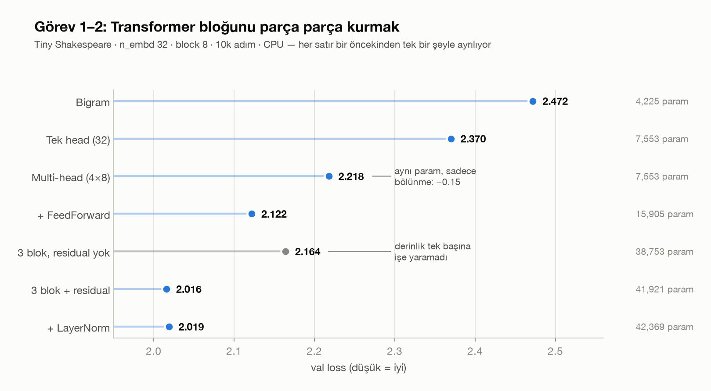
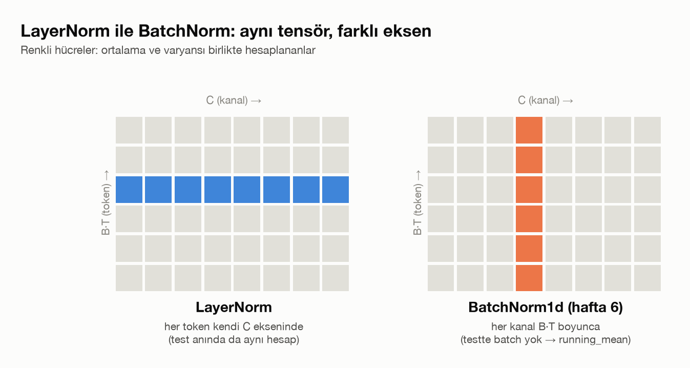
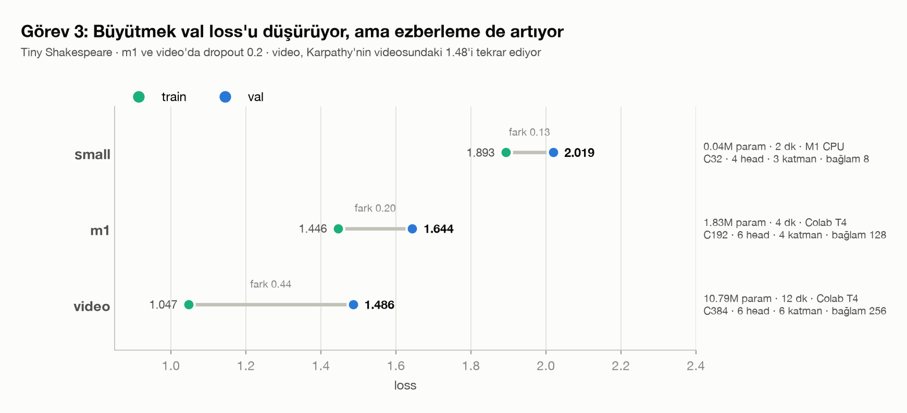
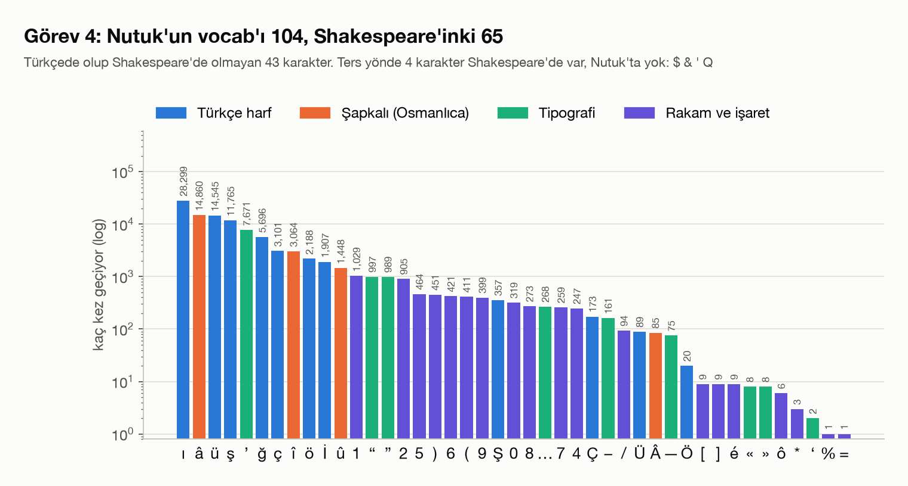
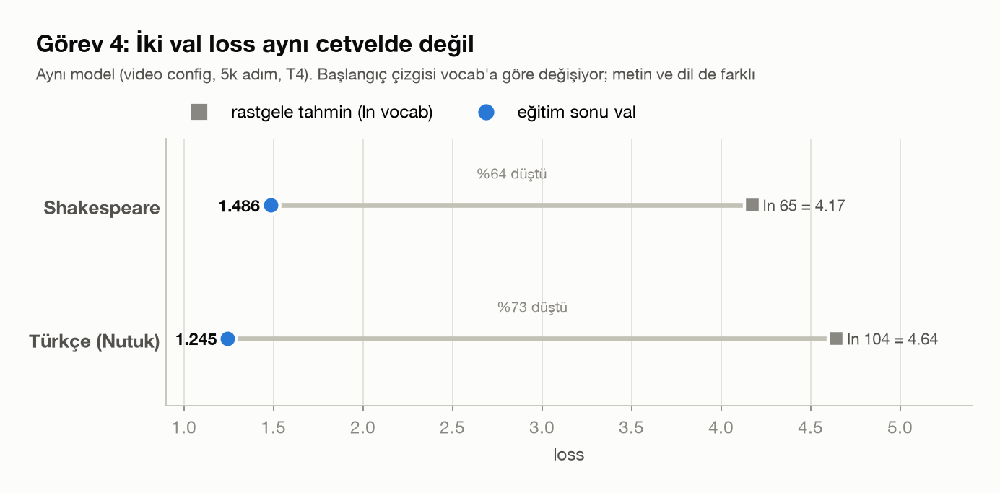
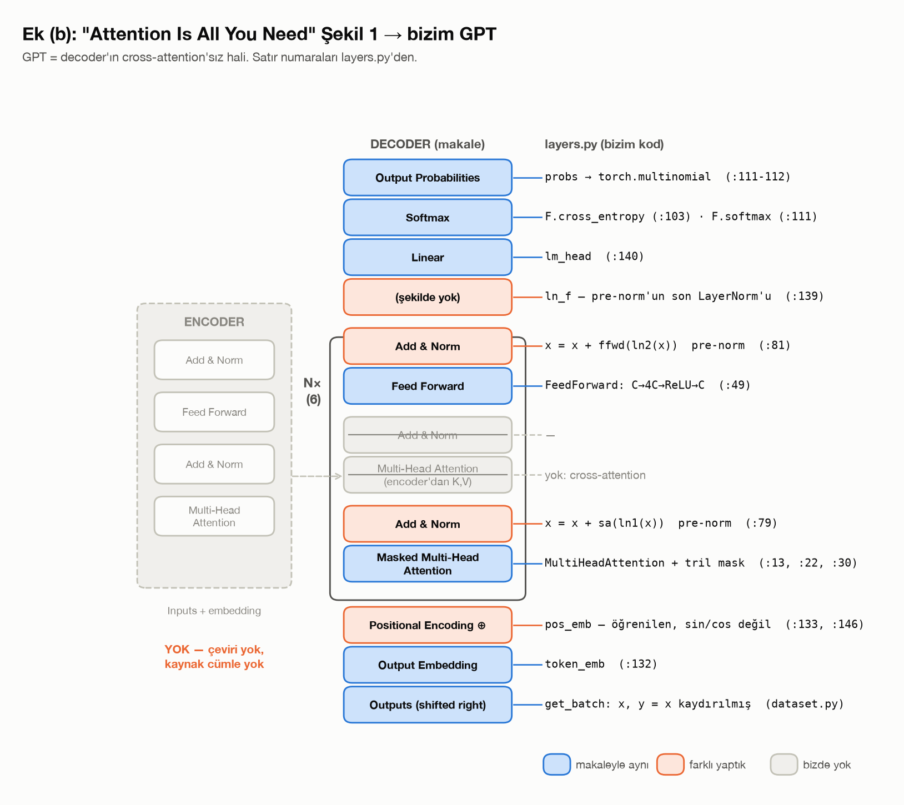

# Hafta 8: Transformer bloğu, büyütme ve Türkçe (Let's build GPT, ikinci bölüm)

## Kaynaklar
- Andrej Karpathy, [Let's build GPT: from scratch, in code, spelled out](https://www.youtube.com/watch?v=kCc8FmEb1nY) (1:22 – sonu)
- [karpathy/ng-video-lecture](https://github.com/karpathy/ng-video-lecture), [karpathy/nanoGPT](https://github.com/karpathy/nanoGPT)
- Vaswani vd. 2017, [Attention Is All You Need](https://arxiv.org/abs/1706.03762) (Şekil 1, ek görev)
- [Vikikaynak: Nutuk](https://tr.wikisource.org/wiki/Nutuk) (görev 4 verisi, 1927, kamu malı)

**Amaç:** hafta 7'deki tek head'den videonun sonundaki GPT'ye gitmek. Bloğun her parçası (multi-head, feed-forward, residual, LayerNorm) **ayrı ayrı** eklenip etkisi ölçülüyor; sonra model büyütülüp dropout ekleniyor ve aynı model Türkçe bir metinle eğitiliyor.

Bu hafta çözülen görevler:
- **Görev 1:** multi-head attention (`n_head` küçük head, birleştirme), tek head ile aynı parametre sayısında karşılaştırma
- **Görev 2:** bloğu parça parça kurmak: FFN, residual, LayerNorm; ablation tablosu; LayerNorm ile hafta 6'daki BatchNorm1d farkı
- **Görev 3:** büyütme + dropout, donanıma göre config seçimi; parametre, val loss, süre, örnek metin
- **Görev 4:** ~1 MB Türkçe metin derleme, eğitim, örnek, vocab karşılaştırması, val loss'ların neden doğrudan kıyaslanamadığı
- **Ek (b):** makalenin Şekil 1'ini koddaki parçalarla eşleştirmek

Görseller `make_figures.py` ile üretildi (`figures/`). Görev 3 ve 4'ün sayıları `samples/*.json`'dan okunuyor.

---

## Dosya yapısı

| Dosya | Sorumluluk |
|---|---|
| `dataset.py` | `read_text` (utf-8), `Tokenizer`, `Dataset` (`get_batch`, `device`) |
| `layers.py` | `Head`, `MultiHeadAttention`, `FeedForward`, `Block`, `BigramLanguageModel`, `GPTLanguageModel` |
| `train.py` | görev 3-4: tam GPT'yi eğitir, checkpoint ve örnek kaydeder (`python train.py <config> <veri>`) |
| `ablation.py` | görev 1-2 tablosu: `VARIANTS` listesindeki modelleri aynı seed ve hiperparametrelerle sırayla eğitir |
| `fetch_turkish.py` | görev 4: Vikikaynak'tan Nutuk'u okuma sırasıyla çeker, wikitext'i temizler → `turkce.txt` |
| `colab_train.ipynb` | görev 3-4'ün büyük eğitimleri (Colab T4) |
| `make_figures.py` | README görselleri → `figures/` |
| `samples/` | her eğitimin örnek metni (`.txt`) ve sonuçları (`.json`: config, param, train/val, süre) |
| `input.txt` / `turkce.txt` | Tiny Shakespeare / Nutuk |

`checkpoints/*.pt` repoya alınmadı (52 MB'a kadar).

```bash
python ablation.py                  # görev 1-2 (satır seçmek için VARIANTS listesini düzenle)
python train.py small
python train.py video               # Colab
python train.py video turkce.txt    # Colab
python fetch_turkish.py
python make_figures.py
```

---

## 1. Blok parça parça (görev 1-2)

Hafta 7'deki ayar korunarak her satır bir öncekinden **tek bir şeyle** ayrılıyor: Tiny Shakespeare, `n_embd` 32, `block_size` 8, batch 32, 10k adım, AdamW lr 1e-3, seed 1337, CPU. 5k adımda bigram henüz yakınsamamıştı, bu yüzden 10k.



| varyant | parametre | val |
|---|---|---|
| bigram | 4,225 | 2.472 |
| tek head (1×32) | 7,553 | 2.370 |
| multi-head (4×8) | 7,553 | **2.218** |
| + FeedForward | 15,905 | 2.122 |
| 3 blok, residual yok | 38,753 | 2.164 |
| 3 blok + residual | 41,921 | **2.016** |
| + LayerNorm | 42,369 | 2.019 |

### 1.1 Multi-head

```python
head_size = n_embd // n_head
self.heads = nn.ModuleList([Head(n_embd, head_size, block_size, dropout) for _ in range(n_head)])
out = torch.cat([h(x) for h in self.heads], dim=-1)    # 4 × (B, T, 8) -> (B, T, 32)
```

Bir tane 32'lik head yerine dört tane 8'lik head. **Parametre sayısı aynı** (7,553), val 0.15 düştü. Tek head her konum için tek bir ağırlıklı ortalama alabiliyor; dört head aynı anda dört farklı şeye bakabiliyor (örneğin biri bir önceki harfe, biri kelime başına).

### 1.2 FeedForward

`C → 4C → ReLU → C`, her token için ayrı ayrı ve aynı ağırlıklarla. Attention token'lar arasında bilgi **topluyor**, FFN her token'ın topladığı bilgiyi **işliyor**. Hafta 7'nin sonundaki tespit (attention'dan sonra hesaplama yok) tam bunu söylüyordu. Val 2.218 → 2.122.

Videodan bir sapma: video FFN'i önce 1×, sonra 4× genişlikle ekliyor. Burada her satır tek şey değişsin diye baştan 4× kullanıldı.

### 1.3 Residual

Blokları üst üste koymak tek başına **kötüleştirdi**: 3 blok residualsız 2.164, tek blok 2.122. Derin ağda gradient her katmandan geçerken zayıflıyor.

```python
x = x + self.sa(self.ln1(x))       # her alt katman x'i okuyor, düzeltmesini üstüne ekliyor
x = x + self.ffwd(self.ln2(x))
```

Residual ile `x` bir "akış" (residual stream) haline geliyor: toplama gradient'i değiştirmeden geçirdiği için en alttaki katman da doğrudan öğrenebiliyor. Val 2.016, aynı derinlikte 0.15 düşüş. Residual'a geri yazmadan önce head dilimlerini karıştıran `proj` katmanı da bu adımda eklendi.

Yan etki: step 0 loss'u 4.63, rastgele tahminin `ln 65 = 4.17`'sinin üstünde. Akışa her blok bir şey ekledikçe başlangıçta logit'ler büyüyor.

### 1.4 LayerNorm

Pre-norm: alt katmana giden **kopya** normalize ediliyor, akışın kendisi değil. En sonda `lm_head`'den önce bir `ln_f` daha var.

Val 2.019: residual ile fark gürültü içinde. Bu boyda (3 blok, 32 boyut) eğitim zaten kararlı. Görünen etki başlangıçta: step 0 loss 4.63 → **4.31**, `ln 65`'e çok daha yakın. LayerNorm'un asıl faydasının derin modellerde olması bekleniyor; görev 3'teki 6 bloklu model LayerNorm'la eğitildi, LayerNorm'suz hali denenmedi.

### 1.5 LayerNorm ve BatchNorm



> LayerNorm her token'ı kendi C ekseninde normalize ediyor. BatchNorm her kanalı B ve T boyunca normalize ediyor. LayerNorm sadece token'ın kendi değerlerini kullanıyor, biriktirmeye gerek yok.

BatchNorm'un ortalaması batch'teki diğer örneklere bağlı; testte tek örnek geldiğinde batch yok, bu yüzden eğitim sırasında `running_mean` / `running_var` biriktirmek zorunda (hafta 6). LayerNorm'da eğitimde ve testte hesap birebir aynı, hafta 6'daki 3D BatchNorm ekseni hatası gibi bir tuzak da yok.

---

## 2. Büyütme ve dropout (görev 3)

Donanım: Apple M1, 8 GB, MPS. MPS belleği sistemle paylaştığı için `m1` config'i (1.8M parametre) lokalde eğitilirken **bilgisayar çöktü**. Bu yüzden: küçük config lokal CPU'da, `m1` ve videodaki boy Colab T4'te.

| config | `n_embd` / head / katman / bağlam | batch | dropout | lr | adım |
|---|---|---|---|---|---|
| `small` | 32 / 4 / 3 / 8 | 32 | 0 | 1e-3 | 10k |
| `m1` | 192 / 6 / 4 / 128 | 32 | 0.2 | 3e-4 | 5k |
| `video` | 384 / 6 / 6 / 256 | 64 | 0.2 | 3e-4 | 5k |



| config | parametre | train | val | val − train | süre | cihaz |
|---|---|---|---|---|---|---|
| `small` | 42,369 | 1.893 | 2.019 | 0.13 | 2 dk | M1 CPU |
| `m1` | 1,827,137 | 1.446 | 1.644 | 0.20 | 4 dk | T4 |
| `video` | 10,788,929 | 1.047 | **1.486** | 0.44 | 12 dk | T4 |

`video` sonucu videodakiyle aynı (~1.48). `small` sonucu ablation'ın son satırını birebir tekrarlıyor (2.019): `train.py` ile `ablation.py` aynı modeli kuruyor.

**Dropout** üç yerde: attention ağırlıklarında (`wei`), `proj` sonrasında ve FFN'in sonunda; yani her alt katman akışa eklenmeden hemen önce. Eğitimde her adımda rastgele bir alt ağ eğitiliyor, `model.eval()` ile kapanıyor (`estimate_loss` ve örnek üretimi eval modunda).

**Ezberleme:** val − train farkı 0.13 → 0.44. 10.8M parametre 1M karakterlik metin için çok; dropout 0.2 farkı azaltıyor ama kapatmıyor. Daha uzun eğitimde val bir noktada yükselmeye başlar.

Örnekler (`samples/`):

```
small (bağlam 8):
KING HENRY VINCENTIO:
Ona, bey not do to a'd fraly bein;
At did noke old not arues,

m1 (bağlam 128):
KING RICHARD III:
What state has he peers; but but mave from as I,
Your sing? This vow'd my stain Edward in thee,

video (bağlam 256):
FLORIZEL:
Send for better lay in a restition
Despise presence: that see, if he loves doubt--

LEONTES:
I' the wealing sire
That valour's vennious; he has been husband,
```

`small`'da kelimelerin çoğu uydurma. `video`'da kelimeler neredeyse hep gerçek, ve 256 karakterlik bağlam sahne düzeyinde tutarlılık getiriyor: FLORIZEL, LEONTES, PERDITA aynı oyundan (Kış Masalı); biraz sonra ROMEO, JULIET, FRIAR LAURENCE bir arada.

---

## 3. Türkçe (görev 4)

### 3.1 Veri

Vikikaynak'ta romanların çoğu birkaç bölümden ibaret; büyük sayfaların çoğu iddianame ve konuşma metni. Tek parça ve yeterince büyük eser olarak **Nutuk** seçildi.

`fetch_turkish.py`: içindekiler → 20 bölüm → ~400 kısım zincirini okuma sırasıyla izliyor, her sayfanın ham wikitext'ini (`action=raw`) çekip şablonları (iç içe `{{...}}`), tabloları, dipnotları, linkleri ve HTML etiketlerini temizliyor. Sonuç: **1,101,042 karakter** (1.2 MB), Tiny Shakespeare ile hemen hemen aynı boy.

```
1335 senesi Mayıs’ının on dokuzuncu günü Samsun’a çıktım. Vaziyet ve manzara-i umumiye:

Osmanlı Devleti’nin dahil bulunduğu grup, Harb-i Umumî’de mağlûp olmuş, ...
```

### 3.2 Vocab



Vocab **104** (Shakespeare 65). Nutuk'ta olup Shakespeare'de olmayan 43 karakter, ters yönde 4 (`$ & ' Q`):
- **Türkçe harfler:** ı (28 bin kez), ü, ş, ğ, ç, ö, İ ve büyükleri
- **Şapkalı harfler:** â, î, û, Â; Osmanlıca kelimeler (hilâfet, riyâset, millî)
- **Tipografi:** kesme işareti düz `'` değil `’` (Samsun’a); “ ”, « », – — …
- **Rakam ve işaret:** Shakespeare'de tek rakam `3`; Nutuk'ta tarihler ve vesika numaraları

Sağ uçtaki karakterler (`%`, `=`, `‘`, `*`) 1-3 kez geçiyor: model bunları öğrenemez, ama vocab'ı ve dolayısıyla softmax'ın seçenek sayısını büyütüyorlar.

### 3.3 Sonuç

Aynı `video` config, 5k adım, T4: 10,818,920 parametre (vocab büyüdüğü için embedding ve `lm_head` biraz daha büyük), 12 dk.

| | vocab | train | val |
|---|---|---|---|
| Shakespeare | 65 | 1.047 | 1.486 |
| Türkçe (Nutuk) | 104 | 0.789 | **1.245** |

```
Heyet-i Murahhasa’mız nokta-i nazarımız cevap verdikleri cevap şu idi:

4– İzmir Vilâyeti ve Elaziz vilâyeti ve Umumî Kolordu Kumandanı Rediye Emir ana hitap vereceği
esnasında ta’dîlât alan fikirlerini izah ettim. Yalnız Efendiler, hususî müzherem mahsulların da
mebuslarını okutmak ve İstanbul’un işgaline iştirak ettireceğini bildirdim. [...] 25 Mayıs 1923’te
şu ta’mîmi yazdım (Vesika: 245).
```

Kelimeler çoğunlukla gerçek, Osmanlıca tamlama yapısı (`-i`, `-ı`) ve Nutuk'un kalıpları ("Efendiler", "(Vesika: 245)", tarih biçimi) yerinde. Anlam yok.

### 3.4 Val loss'lar neden doğrudan kıyaslanamaz



Türkçenin val'i düşük, ama bu "Türkçe daha kolay öğrenildi" demek değil:

1. **Vocab farklı.** Loss, 65 ya da 104 seçenekli bir tahminin cross entropy'si. Rastgele tahminin loss'u bile farklı: `ln 65 = 4.17`, `ln 104 = 4.64`. İki sayı aynı yerden başlamıyor.
2. **Metin farklı.** Nutuk tek yazarın tek eseri ve çok tekrarlı (Efendiler, Kumandanı, Paşa, `-i milliye`). Shakespeare onlarca oyun, karakter ve şiir dili. Tahmin edilebilirlik metnin kendisinden geliyor.
3. **Dil farklı.** Türkçe sondan eklemeli: kök başladıktan sonra ekler (`-ları`, `-ndan`, `-miştir`) büyük ölçüde tahmin edilebilir; karakter başına loss bu yüzden düşebilir.
4. **Birim farklı.** Loss karakter başına. Aynı anlamı taşımak için iki dil farklı sayıda karakter kullanıyor; bir karakterin taşıdığı bilgi eşit değil.

Aynı veri üzerinde farklı modeller kıyaslanabilir; aynı model farklı veriler üzerinde kıyaslanamaz.

---

## 4. Makale Şekil 1 → kod (ek b)



Şekil 1 bir çeviri modeli: solda **encoder** kaynak cümleyi okuyor, sağda **decoder** hedef cümleyi üretiyor. Burada çevrilecek kaynak yok, sadece "sonraki karakteri tahmin et" var. GPT, sağ sütunun cross-attention'sız hali.

| Şekil 1 | kod |
|---|---|
| Outputs (shifted right) | `get_batch`: `y`, `x`'in bir kaydırılmışı |
| Output Embedding | `token_emb` |
| Positional Encoding ⊕ | `pos_emb`, `x = tok + pos` |
| N× | `nn.Sequential(*[Block ...])`, `n_layer` |
| Masked Multi-Head Attention | `MultiHeadAttention`; maske `tril` + `masked_fill(-inf)`; Şekil 2'deki `softmax(QKᵀ/√d_k)V` = `Head.forward`; Concat → Linear = `torch.cat` + `proj` |
| Add & Norm | `x = x + self.sa(self.ln1(x))` |
| Multi-Head Attention (encoder'dan K, V) | **yok** |
| Feed Forward | `FeedForward` (512→2048→512 ≙ C→4C→C, ReLU) |
| Add & Norm | `x = x + self.ffwd(self.ln2(x))` |
| (şekilde yok) | `ln_f` |
| Linear | `lm_head` |
| Softmax → Output Probabilities | eğitimde `F.cross_entropy`, üretimde `F.softmax` + `torch.multinomial` |
| Encoder (sol sütun) | **yok** |

Makaleden farklı olanlar:
1. **Decoder-only:** encoder ve cross-attention yok.
2. **Pre-norm:** Şekil 1'de `LN(x + Sublayer(x))` (post-norm), burada `x + Sublayer(LN(x))`. Akış uçtan uca normalize edilmeden geçiyor, derin modelde eğitim daha kararlı. Bedeli: akış sonunda büyümüş geliyor, `lm_head`'den önce `ln_f` gerekiyor.
3. **Öğrenilen pozisyon:** makalede sabit sin/cos. Burada `block_size` sabit ve `generate` bağlamı ona kırpıyor; öğrenilen tablo yeterli.
4. **Dropout yerleri:** makale alt katman çıkışlarında ve embedding toplamında. Burada alt katman çıkışlarında + attention ağırlıklarında, embedding toplamında yok.
5. **Boyut:** makale `d_model` 512, 8 head × 64, N = 6. `video` config 384, 6 head × 64, 6 katman: head başına boyut ve derinlik aynı.

---

## 5. Sonuçların özeti

| model | veri | parametre | bağlam | val |
|---|---|---|---|---|
| bigram | Shakespeare | 4,225 | 1 | 2.472 |
| tek head (hafta 7) | Shakespeare | 7,553 | 8 | 2.370 |
| GPT `small` (3 blok, tüm parçalar) | Shakespeare | 42,369 | 8 | 2.019 |
| GPT `m1` | Shakespeare | 1.83M | 128 | 1.644 |
| GPT `video` | Shakespeare | 10.79M | 256 | **1.486** |
| GPT `video` | Nutuk | 10.82M | 256 | 1.245 (kıyaslanamaz, bkz. 3.4) |

---

## 6. Karşılaşılan sorunlar

| # | sorun | belirti | sebep / çözüm |
|---|---|---|---|
| 1 | `m1` config'i M1'de MPS ile eğitmek | bilgisayar çöktü | 8 GB birleşik bellek GPU ve sistem arasında paylaşılıyor → büyük eğitimler Colab T4'e |
| 2 | 5k adım ablation | bigram yakınsamadı, satırlar kıyaslanamaz | en yavaş öğrenen model de platoya ulaşsın diye 10k adım |
| 3 | Colab VS Code eklentisi | `Unable to assign server. You have too many` | önceki denemelerde açılan sunucular duruyordu; tarayıcıdan Colab'a geçildi |
| 4 | `files.upload()` VS Code'da | dosya seçme penceresi açılmıyor | o pencereyi yalnızca tarayıcı açabiliyor; VS Code'da Explorer → *Upload to Colab* |
| 5 | Vikikaynak API'si curl ile | boş yanıt, `JSONDecodeError` | URL'deki Türkçe karakterler kodlanmamış → `curl -G --data-urlencode` |
| 6 | `urllib` ile HTTPS | `CERTIFICATE_VERIFY_FAILED` | python.org kurulumunda sertifika paketi yok → macOS'un `/etc/ssl/cert.pem`'i |
| 7 | ~230 sayfa üst üste istek | `HTTP Error 429: Too many requests` | istekler arası 0.5 sn + 429'da `Retry-After` kadar bekleyip tekrar deneme |
