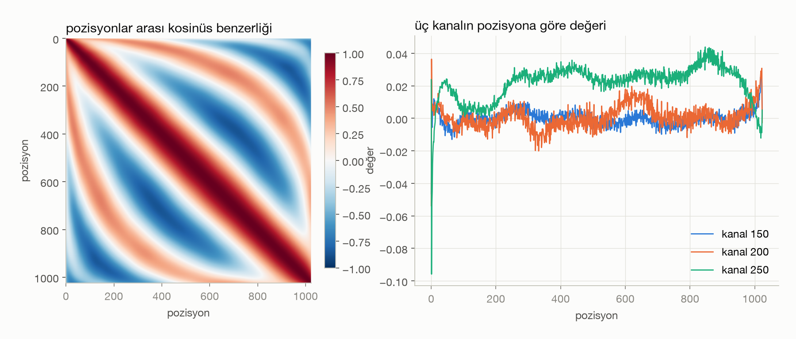
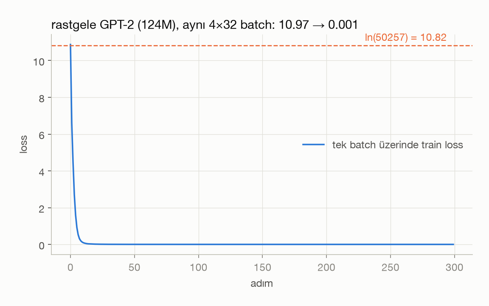
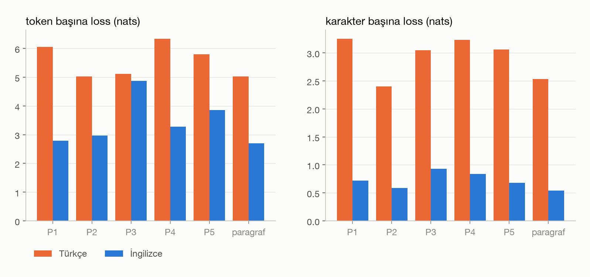

# Hafta 10: GPT-2'yi sıfırdan yazmak (Let's reproduce GPT-2, ilk saat)

## Kaynaklar
- Andrej Karpathy, [Let's reproduce GPT-2 (124M)](https://www.youtube.com/watch?v=l8pRSuU81PU) (0:00 – 1:02)
- [karpathy/build-nanogpt](https://github.com/karpathy/build-nanogpt)
- Radford vd. 2019, [Language Models are Unsupervised Multitask Learners](https://cdn.openai.com/better-language-models/language_models_are_unsupervised_multitask_learners.pdf) (GPT-2 makalesi)
- Hugging Face, [openai-community/gpt2](https://huggingface.co/openai-community/gpt2)
- Veri: hafta 8'deki `week08/input.txt` (Tiny Shakespeare), hafta 9'daki TR/EN paragraf çifti

**Amaç:** hafta 8'de yazdığımız GPT'yi GPT-2 (124M) boyutuna ve isimlerine getirmek, OpenAI'ın eğittiği ağırlıkları kendi kodumuza yükleyip Hugging Face ile aynı çıktıyı aldığımızı göstermek. Sonra modeli konuşturuyoruz, rastgele başlatıp eğitime hazır olduğunu iki basit testle kontrol ediyoruz.

Bu hafta çözülen görevler:
- **Görev 1:** HF GPT-2 ağırlıklarının adları ve boyutları, toplam parametre, pozisyon embedding'i (`wpe`)
- **Görev 2:** kendi GPT-2 modülümüz, HF ağırlıklarını yüklemek, logits eşitliği, hafta 8'den farklar, transpoz
- **Görev 3:** top-k sampling, İngilizce ve Türkçe başlangıç, Türkçenin GPT-2 tokenizer'ındaki maliyeti
- **Görev 4:** rastgele başlatılmış modelin ilk loss'u ve tek batch'i ezberletmek (yan bulgu: MPS hatası)
- **Ek (b):** GPT-2'nin Türkçe ve İngilizce cümlelerdeki loss'u

Sayıların hepsi `samples/` altındaki çıktılardan geliyor. Görselleri scriptler kendisi üretiyor (`figures/`).

---

## Dosya yapısı

| Dosya | Sorumluluk |
|---|---|
| `gpt2.py` | `GPTConfig`, `CausalSelfAttention`, `MLP`, `Block`, `GPT` (`from_pretrained`, top-k `generate`), `get_device` |
| `inspect_hf.py` | görev 1: HF `state_dict` tablosu, parametre sayısı, `figures/01_wpe.png` |
| `compare_logits.py` | görev 2: aynı girdide bizim logits ile HF logits'i |
| `sample.py` | görev 3: EN/TR başlangıçlarla örnek, token sayıları |
| `first_steps.py` | görev 4: ilk loss, tek batch ezberleme, `figures/02_overfit.png` |
| `mps_bug.py` | görev 4'te çıkan MPS hatasının en küçük tekrarı |
| `tr_en_loss.py` | ek (b): TR/EN cümle loss'u, `figures/03_tr_en_loss.png` |
| `paragraphs.py` | hafta 9'daki TR/EN paragraf ve ek (b) cümle çiftleri |
| `style.py` | hafta 8 figür paleti |
| `samples/` | her scriptin çıktısı (`.txt`, `.json`) |

Çalıştırma (kök dizindeki `.venv`, `transformers` ve `tiktoken` gerekli; ağırlıklar ilk çalıştırmada indiriliyor, ~550 MB):

```bash
cd week10
../.venv/bin/python inspect_hf.py
../.venv/bin/python compare_logits.py
../.venv/bin/python sample.py
../.venv/bin/python first_steps.py
../.venv/bin/python tr_en_loss.py
```

Donanım: Apple M1, 8 GB. Sampling MPS'te, görev 4 CPU'da çalıştı (nedeni aşağıda).

---

## Görev 1: Hazır GPT-2'yi incelemek

`GPT2LMHeadModel.from_pretrained("gpt2")` ile 149 anahtar geliyor (tam liste `samples/inspect_hf.txt`'te). Bir bloğun ağırlıkları:

| Anahtar | Boyut | Parametre |
|---|---|---:|
| `transformer.wte.weight` | (50257, 768) | 38,597,376 |
| `transformer.wpe.weight` | (1024, 768) | 786,432 |
| `h.0.ln_1.weight` / `.bias` | (768,) | 768 + 768 |
| `h.0.attn.c_attn.weight` / `.bias` | (768, 2304) / (2304,) | 1,769,472 + 2,304 |
| `h.0.attn.c_proj.weight` / `.bias` | (768, 768) / (768,) | 589,824 + 768 |
| `h.0.ln_2.weight` / `.bias` | (768,) | 768 + 768 |
| `h.0.mlp.c_fc.weight` / `.bias` | (768, 3072) / (3072,) | 2,359,296 + 3,072 |
| `h.0.mlp.c_proj.weight` / `.bias` | (3072, 768) / (768,) | 2,359,296 + 768 |
| `transformer.ln_f.weight` / `.bias` | (768,) | 768 + 768 |
| `lm_head.weight` | (50257, 768) | (wte ile aynı tensör) |

**Toplam parametre: 124,439,808.**
- `wte` 38,597,376 (%31), `wpe` 786,432
- bir blok 7,087,872 (attention 2,362,368 + MLP 4,722,432 + iki LayerNorm 3,072) × 12 = 85,054,464
- `ln_f` 1,536

`state_dict`'teki sayıları düz toplarsak 163,037,184 çıkıyor, çünkü `lm_head.weight` ve `wte.weight` aynı belleği paylaşıyor (`data_ptr` eşit) ve iki kez sayılıyor. Bu **weight tying**: token'ı vektöre çeviren matris ile vektörü token skorlarına çeviren matris aynı.

Not: Videoda `attn.bias` anahtarları da görünüyor (maske). `transformers` 5.x'te maske artık `state_dict`'te değil, o yüzden 149 anahtar var. Yükleme kodu iki durumu da atlıyor.

### Pozisyon embedding'i (`wpe`)



`wpe` 1024 × 768'lik bir tablo: her pozisyon için 768 sayı. Bu sayıları doğrudan ısı haritası olarak çizince kanal kanal dikey çizgiler görünüyor, ama pozisyonla ilgili bir şey okunmuyor. Sol panelde her pozisyon çiftinin vektörleri arasındaki kosinüs benzerliği var.

Ne görüyorum:
- **Yakın pozisyonların vektörleri neredeyse aynı.** Komşu pozisyonlarda benzerlik ortalaması 0.997, 10 pozisyon arayla 0.987, 100 arayla 0.471, 500 arayla 0.246. Model "5. token" ile "6. token"ı birbirine çok yakın, "5." ile "500."ü farklı görüyor.
- **Benzerlik dalga gibi iniyor ve çıkıyor.** Köşegene paralel kırmızı ve mavi bantlar sinüs ve kosinüse benziyor. "Attention Is All You Need"deki sabit sinüs pozisyon kodlamasına benzer bir yapıyı model hiç söylenmeden, kendisi öğrenmiş. GPT-2'de `wpe` sabit değil, sıfırdan öğrenilen bir parametre.
- **Tek kanallar gürültülü (sağ panel).** Eğriler genel bir dalga izliyor ama üstünde çok titreşim var. Karpathy de buna "model tam eğitilmemiş" işareti diyor: iyice eğitilmiş bir modelde bu eğrilerin daha düzgün olmasını beklerdik.
- **Pozisyon 0 ve son pozisyonlar ayrı.** Kanal 250 pozisyon 0'da −0.095'e düşüyor, diğer her yerde 0 ile 0.04 arasında. İlk token'ın önünde bağlam yok, model ona özel bir vektör öğrenmiş. 1000'den sonraki pozisyonlar eğitimde daha seyrek görüldüğü için kenarlarda eğriler dağılıyor.

---

## Görev 2: GPT-2'yi kendimiz yazmak ve ağırlıkları yüklemek

`gpt2.py`, hafta 8'deki `layers.py`'den yola çıkıyor. Modül adları HF'deki anahtarlarla birebir aynı seçildi (`transformer.wte`, `transformer.h.0.attn.c_attn` ...). Böylece `from_pretrained` iki `state_dict`'i anahtar anahtar eşleyip kopyalayabiliyor.

### Logits karşılaştırması (`compare_logits.py`)

Girdi: `"Hello, I'm a language model, and Merhaba, ben bir dil modeliyim."` (20 token), iki model de `eval()` modunda ve CPU'da.

| Ölçü | Değer |
|---|---|
| logits boyutu | (1, 20, 50257), iki modelde de |
| en büyük mutlak fark | 1.22e-04 |
| ortalama mutlak fark | 2.32e-05 |
| `torch.allclose(atol=1e-4)` | True |
| her pozisyonda argmax aynı | True |

Logits'in büyüklüğü ~126 (ör. son pozisyonda bizim −125.91697, HF −125.91696). 1e-4'lük fark göreli olarak ~1e-6, yani float32'de toplamaların sırası farklı olduğu için çıkan yuvarlama farkı. **İki model aynı fonksiyonu hesaplıyor.**

### Hafta 8'deki GPT'den farklar

1. **Aktivasyon: ReLU yerine GELU.** `nn.GELU(approximate='tanh')`. GPT-2 tanh yaklaşımını kullanıyor (o zaman tam `erf` yavaştı). Ağırlıklar bu fonksiyonla eğitildiği için birebir aynısını kullanmak gerekiyor. GELU 0'ın altında tamamen sıfırlamıyor, küçük bir gradyan bırakıyor. ReLU'daki "ölü nöron" sorunu böyle azalıyor.
2. **q, k, v tek katmanda.** Hafta 8'de her `Head`'in kendi `key`, `query`, `value` Linear'ı vardı ve head'ler `ModuleList`'te tek tek çalışıyordu. Burada tek bir `c_attn: 768 → 2304` hepsini birden hesaplıyor, sonra `split` ile üçe bölünüyor. Head'ler `(B, nh, T, hs)` şeklinde ayrı bir boyuta alınıp tek matmul'da paralel çalışıyor. Matematik aynı, GPU için çok daha verimli.
3. **Attention ve projeksiyonlarda bias var.** Hafta 8'de `key/query/value` `bias=False` idi. GPT-2'nin `c_attn`'inde bias var (2304).
4. **Dropout yok.** Burada sadece yükleme, sampling ve küçük testler yapıyoruz. HF config'inde 0.1 dropout var, ama build-nanogpt de dropout kullanmıyor.
5. **Ölçek.** vocab 65 karakter → 50,257 BPE token, `block_size` 256 → 1024, `n_embd` 384 → 768, 6 blok / 6 head → 12 blok / 12 head. 10.8M → 124M parametre.
6. **Config dataclass ve `ModuleDict`.** Hiperparametreler `GPTConfig`'te. `transformer` bir `nn.ModuleDict`, bloklar `nn.Sequential` yerine `nn.ModuleList` (`h`). Bunun tek nedeni anahtar isimlerinin HF'le uyuşması.
7. **Maske buffer'ının adı `bias`.** İçeriği hafta 8'deki `tril` ile aynı. Sadece OpenAI/HF böyle adlandırdığı için bu ad seçildi.
8. **Pre-norm ve `ln_f`, hafta 8'le aynı.** LayerNorm alt katmanın girişinde (`x + attn(ln_1(x))`) ve en sonda `ln_f` var. Orijinal Transformer'da (post-norm) LN toplamdan sonraydı. GPT-2 makalesi LN'yi girişe taşıdığını ve sona `ln_f` eklediğini özellikle yazıyor. Biz bunu hafta 8'de zaten böyle yapmıştık.
9. **Weight tying henüz yok.** HF'de `lm_head` ve `wte` aynı tensör. Bizde ayrı. Yüklerken ikisine aynı değerleri kopyaladığımız için logits aynı çıkıyor, ama bizim modelin parametre sayısı 163,037,184. Aradaki 38,597,376 parametre (toplamın %24'ü) tying'le kazanılacak.
10. **Top-k sampling.** `generate` artık bütün vocab'tan değil, en olası 50 token'dan çekiyor (görev 3).

### Neden bazı ağırlıkları transpoze ediyoruz?

OpenAI GPT-2'yi TensorFlow'da yazdı. Linear katmanlar için `Conv1D` adında bir katman kullandı. Bu katman ağırlığı **(girdi, çıktı)** şeklinde saklıyor ve `x @ W` hesaplıyor. HF uyumluluk için aynı sınıfı korumuş. PyTorch'un `nn.Linear`'ı ise ağırlığı **(çıktı, girdi)** saklıyor ve `x @ W.T` hesaplıyor. Matematik aynı, saklama düzeni ters.

Bu dört ağırlık `Conv1D`'den geliyor: `attn.c_attn`, `attn.c_proj`, `mlp.c_fc`, `mlp.c_proj`. Örneğin HF'deki `c_attn.weight` (768, 2304), bizimki (2304, 768). Yüklerken `.t()` ile çeviriyoruz. Embedding'ler, LayerNorm'lar ve bias'lar vektör ya da zaten aynı düzende olduğu için olduğu gibi kopyalanıyor.

Dikkat edilmesi gereken bir nokta: `attn.c_proj.weight` (768, 768) kare. Transpoz unutulsa boyut kontrolü hata vermez, yanlış ağırlık sessizce yüklenir. Logits karşılaştırması bu yüzden önemli. Çeviriyi `from_pretrained` içinde `assert sd_hf[k].shape[::-1] == sd[k].shape` ile kontrol ediyoruz.

---

## Görev 3: Modeli konuşturmak

`generate` her adımda son pozisyonun logits'ini alıyor, softmax ile olasılığa çeviriyor, **en olası 50 token** dışındakileri atıyor (`torch.topk`), kalanlar arasından `multinomial` ile çekiyor ve `gather` ile gerçek token id'sine dönüyor. Top-k, olasılığı çok düşük binlerce token'ın toplamda örneği raydan çıkarmasını engelliyor. 5 örnek, 40 token, tohum 42, MPS'te. Tam çıktı `samples/sample.txt`'te.

**İngilizce** (`"Hello, I'm a language model,"`, 8 token):
> Hello, I'm a language model, not a model itself. I've found a way to create more expressive and concise expressions than the past and a much wider vocabulary is available. One of the key
>
> Hello, I'm a language model, and I don't want to see human language become the language of the future. You don't have much to lose. I hope at the same level you can

**Türkçe** (`"Merhaba, ben bir dil modeliyim,"`, 11 token):
> Merhaba, ben bir dil modeliyim, cieren cen veybe ndal veyde,  Nam hag dzhiye veyde s
>
> Merhaba, ben bir dil modeliyim, deyaa poyem balyiyim.  Prayer was asked to write for the National Bank, the Treasury Department and

**Türkçe, Türkçe harflerle** (`"İstanbul'dan Ankara'ya giden hızlı tren, sabahın erken saatlerinde"`, 28 token):
> İstanbul'dan Ankara'ya giden hızlı tren, sabahın erken saatlerindeği. Ainım zıltamü
>
> İstanbul'dan Ankara'ya giden hızlı tren, sabahın erken saatlerinde yanarı.  Translation from the Turkish:

İngilizce çıktılar dil bilgisi olarak düzgün, anlam olarak tutarsız (124M için beklenen). Türkçe çıktılar Türkçeye benzeyen ama Türkçe olmayan heceler (`veyde`, `balyiyim`, `kekırı`) ya da birkaç token sonra İngilizceye kaçıyor. İkinci örnekte model metni "Turkish'ten çeviri" diye yorumluyor.

### Neden kötü?

- **Eğitim verisi neredeyse tamamen İngilizce.** GPT-2, Reddit'te paylaşılan bağlantılardan derlenen WebText'te (40 GB) eğitildi. Makale çeviri bölümünde İngilizce olmayan sayfaların filtrelendiğini, Fransızcanın bile sadece ~10 MB kaldığını söylüyor. Türkçe çok daha az. Model Türkçe kelime sıralarını neredeyse hiç görmedi.
- **Tokenizer İngilizceye göre öğrenildi.** Merge'ler WebText'ten çıktı, Türkçe ekler ve harfler için merge yok:

| Cümle | Karakter | GPT-2 token | `cl100k_base` token |
|---|---:|---:|---:|
| `Hello, I'm a language model,` | 28 | 8 | 8 |
| `Merhaba, ben bir dil modeliyim,` | 31 | 11 | 11 |
| `İstanbul'dan Ankara'ya giden hızlı tren, sabahın erken saatlerinde` | 66 | 28 | 22 |

GPT-2'nin bölmesi:
```
EN : Hello | , |  I | 'm |  a |  language |  model | ,
TR : Mer | hab | a | , |  ben |  bir |  dil |  model | iy | im | ,
TR2: � | � | stanbul | 'd | an |  Ankara | ' | ya |  g | iden |  h | ı | zl | ı |  t | ren | , |  sab | ah | ı | n |  er | ken |  sa | at | ler | ind | e
```

`İ` (2 byte) tek token bile değil, iki ayrı byte token'ına bölünüyor (`� | �`). `ı` her geçtiğinde tek başına bir token (`h | ı | zl | ı`). `hızlı` 4 token, `sabahın` 4 token, `saatlerinde` 5 token. Model bir kelimeyi anlamlı bir parça olarak değil, harf öbekleri olarak görüyor. Doğru devam ettirmesi için birçok token'ı arka arkaya doğru tahmin etmesi gerekiyor.

**Hafta 9'daki paragrafla** (aynı içerik, TR ve EN):

| | Kelime | Byte | GPT-2 token | token/kelime | `cl100k` token | token/kelime |
|---|---:|---:|---:|---:|---:|---:|
| TR | 33 | 338 | 155 | 4.70 | 121 | 3.67 |
| EN | 64 | 370 | 74 | 1.16 | 73 | 1.14 |

Hafta 9'da GPT-4'ün tokenizer'ında (`cl100k_base`) Türkçe kelime başına İngilizcenin 3.2 katı token tutuyordu. **GPT-2'de bu 4.05 kat.** Aynı içerik için Türkçe 2.1 kat daha fazla token harcıyor, yani 1024'lük bağlama İngilizcenin yarısı kadar Türkçe metin sığıyor. Hafta 9'daki kendi tokenizer'ımız (Nutuk'ta eğitilmiş, sadece 512 vocab) aynı TR paragrafı 174 token'a indirmişti. GPT-2'nin 50,257'lik vocab'ı 100 kat büyük olduğu halde bunun ancak biraz altına iniyor (155), çünkü o merge'ler İngilizce için harcanmış. Hafta 9'daki sonuç burada da geçerli: tokenizer hangi dilde eğitildiyse o dili ucuza sıkıştırıyor.

---

## Görev 4: İlk eğitim adımları

`first_steps.py`: GPT-2 boyutunda ama **rastgele başlatılmış** model (PyTorch'un varsayılan init'i, HF ağırlıkları yok), Tiny Shakespeare GPT-2 tokenizer'ıyla 338,025 token, B = 4, T = 32, AdamW lr 3e-4.

### İlk loss

| | Değer |
|---|---|
| ilk loss (20 rastgele batch ortalaması) | **10.966** |
| ln(50257) | 10.825 |
| fark | +0.141 |
| logits std | 0.577 |
| en büyük olasılık / uniform (1/50257) | 3.2e-4 / 2.0e-5 |

**Neden ~10.8 olmalı:** Henüz hiçbir şey öğrenmemiş bir model hiçbir token'ı diğerinden üstün görmemeli, yani olasılığı 50,257 token'a eşit dağıtmalı. O zaman doğru token'ın olasılığı 1/50257 ve cross-entropy −ln(1/50257) = ln(50257) ≈ 10.82. Başlangıç loss'u bu değere yakınsa, başlatma "kimseyi kayırmayan" bir tahminle başlıyor demektir. Çok yukarıdaysa (hafta 8 adım 3'teki 4.63'e karşı ln 65 = 4.17 gibi) model rastgele olduğu halde bazı token'lardan emin. O zaman ilk adımlar bu yanlış özgüveni silmeye gidiyor.

Bizimki 0.14 yukarıda: logits tam sıfır değil (std 0.58), en olası token uniform'dan 16 kat olası. Bunun nedeni PyTorch'un varsayılan başlatması (embedding'ler N(0, 1)). Kabul edilebilir bir başlangıç, ama videonun devamındaki std 0.02 başlatmasıyla daha da yaklaşacak (gelecek hafta).

### Tek batch'i ezberletmek



Aynı 4 × 32 batch'te 300 adım (CPU, 0.9 sn/adım, toplam 292 sn):

| Adım | 0 | 25 | 50 | 100 | 200 | 299 |
|---|---:|---:|---:|---:|---:|---:|
| loss | 10.874 | 0.0088 | 0.0026 | 0.0014 | 0.0008 | **0.0005** |

Sonunda batch'in 128 hedef token'ının **%100**'ünü argmax ile doğru tahmin ediyor. Model `" Citizen:\nBefore we proceed any further, hear me speak. ..."` satırını birebir geri üretiyor. Videoda 50. adımda 0.0029 vardı, bizde 0.0026.

**Bu test neden işe yarıyor:** 163M parametreli bir model için 128 token'ı ezberlemek çok kolay. Bunu yapamıyorsa sorun veride ya da genellemede değil, **kodda**: hedefler yanlış kaydırılmış olabilir, maske yanlış olabilir, gradyan bir yerde kopuyor olabilir, optimizer parametreleri görmüyor olabilir, loss yanlış eksende hesaplanıyor olabilir. Test birkaç saniyede bitiyor, veri yükleyiciyi ve genellemeyi devre dışı bırakıyor, sadece "forward + backward + optimizer zinciri çalışıyor mu" sorusunu soruyor. Loss sıfıra inmezse uzun bir eğitim koşusuna başlamanın anlamı yok.

### Yan bulgu: test gerçekten bir hata yakaladı (MPS)

İlk denemede aynı scripti M1'in GPU'sunda (MPS) çalıştırdım. Loss 300 adımda sıfıra inmedi, zıpladı (10.87 → 6.60 → 15.47 → 3.71) ve doğru tahmin %21'de kaldı. Aynı kod CPU'da 50 adımda 0.0026'ya iniyor. Forward iki cihazda birebir aynıydı (ilk loss 10.8742 ve 10.8742). Bu yüzden gradyanları karşılaştırdım: MPS'teki gradyanlar CPU'dakinden 17 kata kadar farklıydı.

Katmanları tek tek test edince sorun `lm_head`'de çıktı. `x.grad = g @ W` matmul'unun iç boyutu vocab (50,257). MPS bu boyutta yanlış sonuç veriyor (`mps_bug.py`, torch 2.13, macOS 26):

| vocab (iç boyut) | `x.grad` CPU-MPS göreli fark |
|---:|---:|
| 8,192 | 0 |
| 32,768 | 8.6e-06 |
| **50,257** | **9.0e-01 (yanlış)** |
| 50,304 | 7.9e-06 |

Gradyan `lm_head`'den bütün modele geri aktığı için tüm ağırlıklar bozuk yönde güncelleniyordu. Bu yüzden `first_steps.py` MPS varsa CPU'ya geçiyor. Sampling (sadece forward) MPS'te doğru çalışıyor. İlginç bir şekilde 50,304'te (128'in katı) hata yok. Karpathy de videonun ilerisinde vocab'ı hız için 50,304'e yuvarlıyor. Bu hafta bunu yapmadım, çünkü görev ln(50257) ile karşılaştırma istiyor.

Ezberleme testinin değeri burada açıkça görülüyor: kod doğruydu ama donanım katmanında bir hata vardı. Ancak "128 token'ı ezberleyemiyor" gözlemi bunu ortaya çıkardı. Büyük bir eğitimde loss yine düşerdi ve hata fark edilmeyebilirdi.

---

## Ek (b): GPT-2'nin Türkçe ve İngilizce loss'u



`tr_en_loss.py`: HF ağırlıklı model, her cümlenin başına `<|endoftext|>` eklendi (ilk token da tahmin edilsin), toplam negatif log-olabilirlik (nats) token, karakter ve byte sayısına bölündü.

| Cümle | TR token | EN token | TR loss/token | EN loss/token | TR loss/karakter | EN loss/karakter | TR/EN toplam |
|---|---:|---:|---:|---:|---:|---:|---:|
| P1 Bugün hava çok güzel… | 29 | 17 | 6.06 | 2.79 | 3.25 | 0.72 | 3.70× |
| P2 Türkiye'nin başkenti… | 32 | 14 | 5.03 | 2.97 | 2.40 | 0.59 | 3.87× |
| P3 Öğrenciler sınavdan… | 31 | 9 | 5.11 | 4.88 | 3.05 | 0.93 | 3.61× |
| P4 Kitabı okuduktan… | 24 | 12 | 6.34 | 3.28 | 3.24 | 0.84 | 3.86× |
| P5 Yapay zekâ modelleri… | 29 | 12 | 5.80 | 3.86 | 3.06 | 0.68 | 3.63× |
| hafta 9 paragrafı | 155 | 74 | 5.03 | 2.70 | **2.54** | **0.54** | **3.89×** |

Paragrafta byte başına: TR 3.33 bit, EN 0.78 bit.

**Hangi ölçü?** Token başına loss iki dili adil karşılaştırmıyor, çünkü bir Türkçe token bir İngilizce token'dan çok daha az metin taşıyor (hafta 9'da da bu yüzden karakter başına geçmiştik). Asıl karşılaştırma toplam bilgi: aynı anlamı taşıyan cümle için model Türkçede **3.6 – 3.9 kat** daha fazla "şaşırıyor". Karakter başına bakınca fark daha da büyük, paragrafta 2.54'e karşı 0.54 nats (4.7×).

**Fark neden bu kadar büyük:**
1. **Veri.** WebText'te Türkçe neredeyse yok (görev 3). Model Türkçe kelime sırasını, ekleri, kelimelerin birlikte geçme alışkanlıklarını öğrenmedi. İngilizcede ise "The capital of Turkey is" sonrasında "Ankara"yı neredeyse kesin biliyor.
2. **Tokenizer.** Türkçe kelimeler 3-5 parçaya bölünüyor (`h | ı | zl | ı`), `İ` iki byte token'ına ayrılıyor. Her kelime için birden fazla doğru tahmin gerekiyor ve her parçada hata yapma şansı var. Bu parçaların embedding'leri de Türkçe bağlamda neredeyse hiç eğitilmedi.
3. **Dil yapısı.** Türkçe sondan eklemeli: `varacaklarını`, `gecikmeyeceğini` gibi tek kelimede İngilizcede 4-5 kelimelik bilgi var. Aynı içerik daha az kelimeye, ama tokenizer İngilizceye göre olduğu için daha çok token'a dağılıyor.

**Hafta 8-9 ile bağlantı:** Hafta 9 ek (b)'de, Nutuk'ta (1 MB Türkçe) eğittiğimiz ~11M parametreli GPT'nin karakter başına val loss'u **1.25** idi. 124M parametreli GPT-2 Türkçe paragrafta karakter başına **2.54**'te kalıyor. Metinler aynı değil (Nutuk'un dili de çok farklı), o yüzden bu sayılar doğrudan kıyaslanmamalı. Yine de yön açık: 11 kat büyük ama Türkçe görmemiş bir model, küçük ama Türkçe görmüş bir modelden Türkçede kötü. Parametre sayısı veriyi telafi etmiyor.

---

## Gelecek hafta

Videonun 1:02'den sonrası: data loader ile metnin tamamında eğitim, weight tying (38.6M parametre kazancı, yukarıda hesaplandı), std 0.02 başlatması ve residual ölçekleme, ardından hızlandırma (TF32, bf16, `torch.compile`, flash attention, vocab 50,304).
