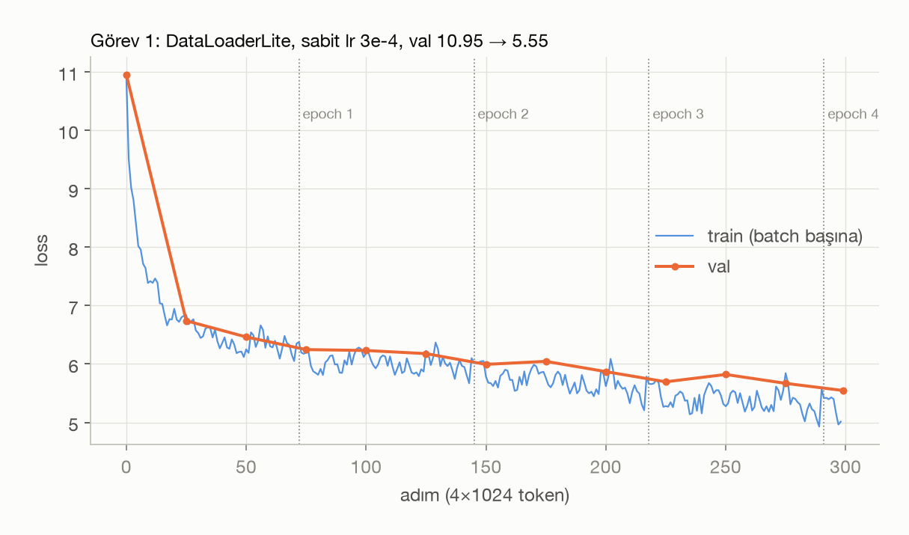
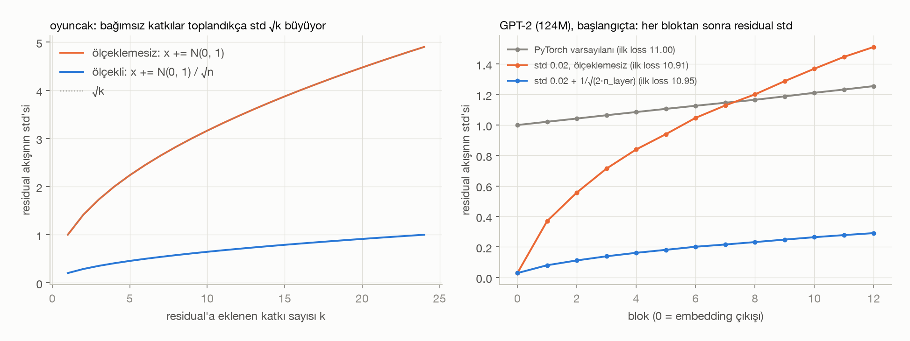
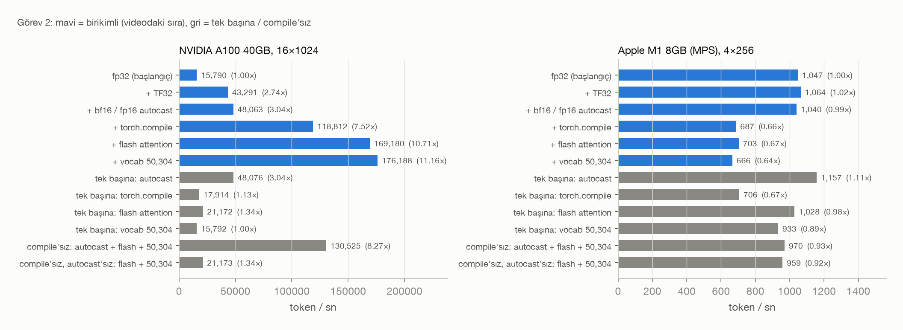
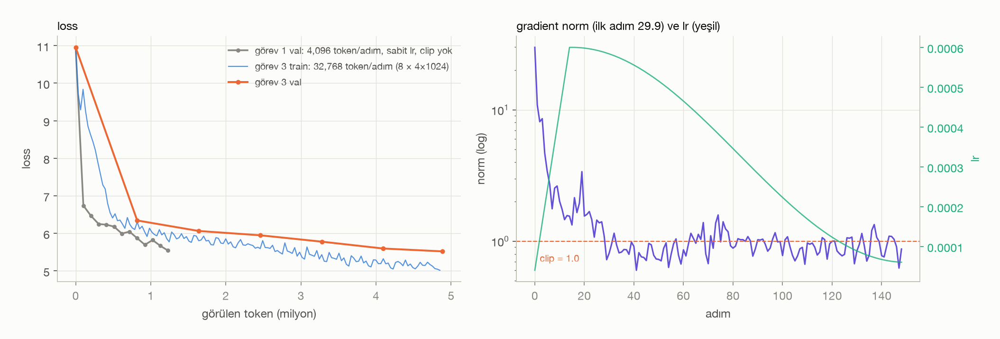
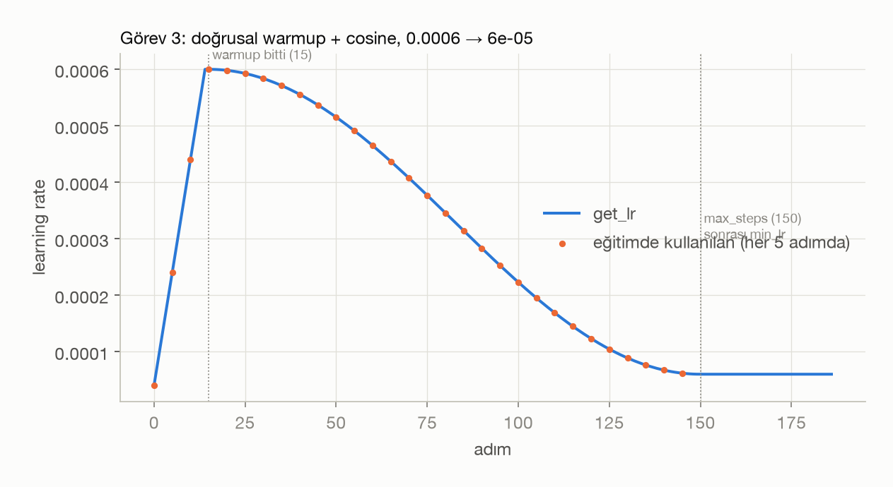
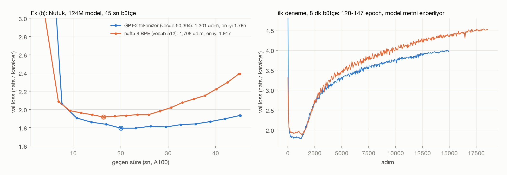

# Hafta 11: GPT-2'yi eğitmeye hazırlamak (Let's reproduce GPT-2, 1:02 – 2:46)

## Kaynaklar
- Andrej Karpathy, [Let's reproduce GPT-2 (124M)](https://www.youtube.com/watch?v=l8pRSuU81PU) (1:02:00 – 2:46:52)
- [karpathy/build-nanogpt](https://github.com/karpathy/build-nanogpt)
- Brown vd. 2020, [Language Models are Few-Shot Learners](https://arxiv.org/abs/2005.14165) (GPT-3 makalesi, ek B: eğitim ayarları)
- Veri: hafta 8'deki `week08/input.txt` (Tiny Shakespeare) ve `week08/turkce.txt` (Nutuk), hafta 9'daki BPE tokenizer (`week09/bpe.py`, `bpe_cache.pt`)

**Amaç:** hafta 10'da yazdığımız GPT-2'yi gerçekten eğitilebilir hale getirmek. Önce veriyi batch'lere bölen bir loader, weight tying ve GPT-2'nin başlatması. Sonra bir eğitim adımını donanımın izin verdiği kadar hızlandırmak. En son GPT-3 makalesindeki eğitim ayarları ve küçük GPU'da büyük batch için gradient accumulation.

Bu hafta çözülen görevler:
- **Görev 1:** `DataLoaderLite`, metnin tamamında eğitim, weight tying, std 0.02 ve residual ölçekleme
- **Görev 2:** adım süresi ve token/sn, TF32 → bf16 → `torch.compile` → flash attention → vocab 50,304 (A100 ve M1)
- **Görev 3:** AdamW (0.9, 0.95), gradient clipping, warmup + cosine lr, yalnız 2 boyutlu parametrelere weight decay, gradient accumulation
- **Ek (b):** aynı model Nutuk'ta aynı sürede, bir kez GPT-2 tokenizer'ıyla, bir kez hafta 9 tokenizer'ıyla

Sayıların hepsi `samples/` altındaki çıktılardan geliyor. Figürleri `init_check.py` ve `make_figures.py` üretiyor.

---

## Dosya yapısı

| Dosya | Sorumluluk |
|---|---|
| `gpt2.py` | hafta 10'daki model + weight tying, GPT-2 başlatması, `flash` bayrağı, `configure_optimizers`, `get_lr`, `sync` |
| `dataloader.py` | `DataLoaderLite`: token dizisini sırayla (B, T) batch'lere bölüyor |
| `data.py` | Shakespeare / Nutuk (GPT-2) / Nutuk (BPE512), %90 train / %10 val, iki tokenizer'da da aynı val metni |
| `train.py` | görev 1, görev 3 ve ek (b)'nin eğitim scripti (CLI) |
| `benchmark.py` | görev 2: her satır ayrı süreçte, medyan adım süresi |
| `init_check.py` | görev 1: tying'in parametre kazancı, residual std ölçümü, `figures/01_residual_std.png` |
| `accum_check.py` | görev 3: accumulation'lı gradyan = büyük batch'in gradyanı mı? |
| `make_figures.py` | `figures/02` – `06` |
| `colab_train.ipynb` | Colab'da benchmark + bütün eğitimler (çıktılarıyla) |
| `style.py` | hafta 8 figür paleti |

Donanım: Apple M1 8 GB ve Colab. Eğitimi önce M1'de denedim. 124M'lik model fp32'de ağırlık, gradyan ve AdamW durumuyla ~2 GB tutuyor, MPS toplamda ~4.5 GB'a çıkıyor. 8 GB'lık makinede bellek dolup diske swap başladı, adım süresi 1 ile 50 sn arasında oynadı. Bu yüzden eğitimler Colab'da koştu. T4 istedik, Colab **A100 40GB** verdi. M1'de çalışanlar: `init_check.py`, `accum_check.py` ve M1 benchmark'ı.

```bash
cd week11
../.venv/bin/python init_check.py
../.venv/bin/python accum_check.py
../.venv/bin/python benchmark.py          # cihazda ne varsa (cuda / mps)
../.venv/bin/python make_figures.py       # samples/*.json -> figures/
# eğitim komutları train.py'nin başında ve colab_train.ipynb'de
```

---

## Görev 1: Data loader, weight tying, başlangıç değerleri

### `DataLoaderLite`

Hafta 10'da hep metnin başındaki aynı batch'i kullanıyorduk. Loader metni bir kez token'a çeviriyor ve bir imleçle sırayla ilerliyor: `x = tokens[i : i+B·T]`, `y = tokens[i+1 : i+B·T+1]`, sonra `i += B·T`. Bir sonraki batch'in `+1`'lik hedefi taşacaksa başa dönüyor (yeni epoch). Rastgele değil sıralı, Karpathy'nin videodaki loader'ı gibi.

Shakespeare GPT-2 tokenizer'ıyla 338,025 token. Bunların %90'ı (301,966) train, %10'u (36,059) val. 4×1024'lük batch'le 1 epoch 73 adım.



300 adım, sabit lr 3e-4, düz AdamW, A100'de 31 sn (adım başına 102 ms, 40K token/sn). Hızlandırma yok, ama `train.py` CUDA'da TF32'yi her zaman açıyor, yani buradaki fp32 matmul'ları TF32. Val loss **10.95 → 5.55**. Model ~4 epoch'ta 1.2M token gördü. Örnek metin (`samples/task1_shakespeare.json`) Shakespeare'in biçimini almış: büyük harfli konuşmacı adları, iki nokta, kısa satırlar. Ama cümleler henüz anlamsız:

> ROMEO:
> For you that this's you her, we had you
> To our death.
> For they think I his good in the honour: by a

### Weight tying

`self.transformer.wte.weight = self.lm_head.weight`: girişte token'ı vektöre çeviren matris ile çıkışta vektörü token skorlarına çeviren matris artık aynı tensör.

| | parametre |
|---|---:|
| tying'siz | 163,037,184 |
| tying'li | 124,439,808 |
| **kazanç** | **38,597,376 (%23.7)** = 50,257 × 768 |

Kazanç modelin dörtte biri. Aynı vektörün iki işi var. Benzer anlamdaki token'ların embedding'leri birbirine yakın olmalı. Aynı şekilde, bir bağlamdan sonra gelebilecek token'ların çıkış skorları da benzer olmalı. GPT-2 ve "Attention Is All You Need" ikisi de bunu yapıyor. Tying'li tensör iki yerden gradyan alıyor: girişten ve çıkıştan.

### Başlangıç değerleri

`_init_weights`: bütün `Linear` ve `Embedding` ağırlıkları N(0, 0.02), bias'lar 0, LayerNorm PyTorch varsayılanında (1, 0). Residual akışına yazan iki katman, `attn.c_proj` ve `mlp.c_proj`, ayrıca `1/√(2·n_layer) = 1/√24 ≈ 0.204` ile çarpılıyor (std 0.0041). 0.02, GPT-2 kodundaki değer. Kabaca `1/√768 ≈ 0.036` ile `1/√3072 ≈ 0.018` arasında, yani Xavier'in verdiği ölçekte.



**Neden ölçekliyoruz?** Her blok residual akışına iki kez bir şey ekliyor: `x = x + attn(ln_1(x))` ve `x = x + mlp(ln_2(x))`. 12 blokta toplam 24 katkı oluyor. Birbirinden bağımsız 24 rastgele sayının toplamının std'si tek tek std'lerin √24 ≈ 4.9 katıdır. Sol panelde bunu doğrudan görüyoruz: std'si 1 olan 24 katkı toplanınca std 4.90'a çıkıyor. Her katkıyı `1/√24` ile küçültünce toplam 1.00'da kalıyor. Gerçek modelde (sağ panel, başlangıçta, Shakespeare'den bir batch) etkisi şu:

| başlatma | embedding çıkışı std | 12. bloktan sonra | büyüme | ilk loss |
|---|---:|---:|---:|---:|
| PyTorch varsayılanı | 0.999 | 1.255 | 1.26× | 11.00 |
| std 0.02, ölçeklemesiz | 0.028 | 1.511 | **53×** | 10.91 |
| std 0.02 + 1/√(2·n_layer) | 0.028 | 0.290 | 10× | 10.95 |

Ölçeklemesiz durumda residual akışı derinlikle büyüyor ve embedding'in sinyali (0.028) blokların ekledikleri yanında kayboluyor. Derin bir modelde bu, aktivasyonların katmandan katmana patlaması demek. Ölçekleme her bloğun katkısını küçük tutuyor. Residual başlangıçta neredeyse kimlik fonksiyonu gibi davranıyor, gradyan da toplama düğümlerinden olduğu gibi aşağı akıyor (hafta 8'de konuştuğumuz "gradyan otoyolu"). İlk loss üçünde de ln(50257) = 10.82'ye yakın, çünkü `ln_f` son katmandan önce ölçeği yine normalize ediyor. Fark loss'ta değil, iç aktivasyonların büyüklüğünde.

PyTorch varsayılanı (`Linear` için U(−1/√in, 1/√in), `Embedding` için N(0, 1)) da patlamıyor. Ama embedding'i 1 ölçeğinde başlattığı için blokların katkısı başlangıçta küçük kalıyor. GPT-2'nin başlatması bunun tersi: embedding küçük, bloklar ondan büyük ama kontrollü.

---

## Görev 2: Eğitimi hızlandırmak

`benchmark.py` her satırı ayrı bir Python sürecinde çalıştırıyor, böylece önceki satırın belleği ya da `torch.compile` önbelleği ölçümü etkilemiyor. 15 adım koşuyor, ilk 5'i (bellek ayırma, compile) atıyor, kalan 10'un medyanını alıyor. Süreyi ölçmeden önce ve sonra `torch.cuda.synchronize()` çağrılıyor. GPU asenkron çalıştığı için bu olmadan Python sadece işi kuyruğa koyma süresini ölçerdi. Satırlar birikimli: her satır öncekinin üstüne bir şey ekliyor (videodaki sıra). Altında her adım fp32'nin üstüne tek başına da ölçüldü.



### A100 40GB, 16×1024 = 16,384 token/adım (`samples/benchmark_cuda.json`)

| adım | ms/adım | token/sn | toplam hızlanma | bu adımın katkısı |
|---|---:|---:|---:|---:|
| fp32 (başlangıç) | 1038 | 15,790 | 1.00× | |
| + TF32 | 378 | 43,291 | 2.74× | **2.74×** |
| + bf16 autocast | 341 | 48,063 | 3.04× | 1.11× |
| + `torch.compile` | 138 | 118,812 | 7.52× | **2.47×** |
| + flash attention | 97 | 169,180 | 10.71× | 1.42× |
| + vocab 50,304 | 93 | 176,188 | **11.16×** | 1.04× |
| *tek başına: compile* | 915 | 17,914 | 1.13× | |
| *tek başına: flash attention* | 774 | 21,172 | 1.34× | |
| *tek başına: vocab 50,304* | 1037 | 15,792 | 1.00× | |
| *compile'sız: bf16 + flash + 50,304* | 126 | 130,525 | 8.27× | |

Videoda Karpathy A100'de 1000 ms → 93 ms'ye iniyor. Biz de aynı yerdeyiz.

**Hangi adım en çok kazandırdı?** Tek adım olarak **TF32** (2.74×), hemen arkasından **`torch.compile`** (2.47×).
- **TF32:** A100'ün tensor çekirdekleri fp32 matmul'u, mantisi 23'ten 10 bite kısaltılmış girdilerle yapıyor. Tek satır kod (`set_float32_matmul_precision("high")`), loss'a etkisi gürültü düzeyinde. Teorik tavan 8× ama tam 8× gelmiyor, çünkü adımın her parçası matmul değil.
- **bf16** üstüne sadece %11 ekliyor. Matmul'lar zaten tensor çekirdeklerinde, bf16'nın asıl kazancı bellekten taşınan byte'ların yarıya inmesi.
- **compile:** tek başına (fp32'nin üstüne) sadece 1.13× kazandırıyor, bf16'dan sonra 2.47×. Fp32'de süreyi matmul'lar belirliyor. TF32 ve bf16 matmul'ları hızlandırınca darboğaz bellekten okuma-yazmaya kayıyor: GELU, LayerNorm, toplamalar gibi her eleman bazlı işlem tensörü GPU belleğinden (HBM) okuyup geri yazıyor. Compile bu işlemleri tek çekirdekte birleştiriyor (kernel fusion), ara sonuçlar bellekten hiç geçmiyor. Yani compile'ın değeri o ana kadar yapılanlara bağlı.
- **Flash attention:** `F.scaled_dot_product_attention(is_causal=True)`. Aynı matematik, ama (T, T)'lik attention matrisini belleğe hiç yazmadan, softmax'ı parça parça (online softmax) hesaplıyor. FLOP sayısı biraz artıyor ama bellek trafiği çok azaldığı için 1.42× kazandırıyor. Compile bu birleştirmeyi kendisi bulamıyor.
- **Vocab 50,304** (= 128 × 393): 47 tane hiç kullanılmayan token ekliyoruz, matmul boyutları 2'nin kuvvetleriyle bölünür hale geliyor ve CUDA çekirdekleri kenardaki artık parçalar için ayrı bir yavaş tur yapmıyor. Burada sadece %4 kazandırıyor. Videoda daha fazlaydı. Tek başına fp32'de ise hiç etkisi yok, çünkü orada darboğaz başka yerde.

### Apple M1 8 GB (MPS), 4×256 = 1,024 token/adım (`samples/benchmark_mps.json`)

| adım | ms/adım | token/sn | hızlanma | not |
|---|---:|---:|---:|---|
| fp32 (başlangıç) | 978 | 1,047 | 1.00× | |
| + TF32 | 962 | 1,064 | 1.02× | NVIDIA'ya özgü, MPS'te etkisiz |
| + fp16 autocast | 985 | 1,040 | 0.99× | M1'de bf16 donanımı yok, fp16 + GradScaler |
| + `torch.compile` | 1490 | 687 | 0.66× | **yavaşlatıyor** |
| + flash attention | 1456 | 703 | 0.67× | CUDA flash çekirdeği yok, MPS'in kendi SDPA'sı |
| + vocab 50,304 | 1538 | 666 | 0.64× | |
| *tek başına: fp16 autocast* | 885 | 1,157 | 1.11× | |
| *tek başına: compile* | 1451 | 706 | 0.67× | |
| *tek başına: flash* | 996 | 1,028 | 0.98× | |
| *tek başına: vocab 50,304* | 1097 | 933 | 0.89× | |

M1'de **hiçbir adım anlamlı kazandırmıyor**. ±%10'luk farklar 8 GB'lık makinedeki bellek baskısının gürültüsü içinde: aynı ayar bir koşuda 1137, bir sonrakinde 978 ms çıktı. Desteklenmeyen ya da etkisiz adımlar:
- **TF32:** NVIDIA Ampere'nin tensor çekirdeklerine özgü. MPS'te ayar kabul ediliyor ama bir şey değiştirmiyor.
- **bf16:** M1'in GPU'sunda bf16 donanımı yok (M2'den sonra var), fp16 kullandık. fp16'nın üs aralığı dar olduğu için gradyanlar taşmasın diye GradScaler gerekiyor. Her adımda bütün gradyanları inf/NaN için kontrol etmek ve autocast'ın ağırlıkları her forward'da fp16'ya çevirmesi kazancı yiyor.
- **`torch.compile`:** MPS'te çalışıyor (inductor'ın Metal arka ucu), ama 0.66×'le yavaşlatıyor. Bu arka uç henüz deneysel, ürettiği Metal çekirdekleri Apple'ın elle yazdığı MPS çekirdeklerinden yavaş.
- **Flash attention:** CUDA'daki FlashAttention çekirdeği yok. `scaled_dot_product_attention` MPS'te kendi çekirdeğine düşüyor. T=256'da attention adımın küçük bir parçası olduğu için etkisi görünmüyor.
- **Vocab 50,304:** M1'de hız kazandırmıyor ama başka bir şeyi düzeltiyor. Hafta 10'da bulduğumuz MPS hatası (`lm_head` geri yayılımında iç boyutu 50,257 olan matmul yanlış gradyan veriyor) 50,304'te yok. Yani M1'de eğitim yapılacaksa 50,304 hız için değil, doğruluk için şart. 50,257'li satırların süreleri geçerli ama o satırlarda gradyanlar yanlış.

---

## Görev 3: GPT-3'ün eğitim ayarları

`train.py --gpt3`: GPT-3 makalesinin ek B'sindeki ayarlar. 150 adım, her adım 32,768 token (8 × 4×1024 micro batch), bf16 + flash + compile + vocab 50,304, A100'de adım başına 218 ms (150K token/sn).



**AdamW, β = (0.9, 0.95), ε = 1e-8.** PyTorch'un varsayılanı β₂ = 0.999. β₂ gradyanın karesinin hareketli ortalaması. 0.95 daha kısa bir pencere demek: gradyan ölçeği değişince (ör. loss sıçramalarında) adım boyu daha çabuk uyum sağlıyor. CUDA'da `fused=True` ile bütün parametrelerin güncellemesi tek çekirdekte yapılıyor.

**Gradient clipping, 1.0.** `clip_grad_norm_` bütün parametrelerin gradyanını tek bir vektör sayıp L2 normunu hesaplıyor. 1'den büyükse vektörü 1'e ölçekliyor (yön aynı kalıyor). Her adımda clip öncesi norm yazdırılıyor (`samples/task3_gpt3.json`):
- İlk adımda **29.9** (10.9, 8.1, 8.6, 4.7 ...). Rastgele modelin loss'u yüksek ve gradyanları büyük. Görev 1'de clip yokken ilk adımın normu da 30.4'tü.
- Warmup boyunca (15 adım) her adım clip'lendi, 1.5 civarına iniyor.
- Sonra 0.6 – 1.6 arasında dolaşıyor. 149 adımın 67'sinde norm 1'in üstündeydi ve clip devreye girdi.
- Cosine'in ilk yarısında (15-80. adım) ortalama norm 1.08, ikinci yarısında (80-149) 0.93.

Clip'in amacı tek bir kötü batch'in (ör. alışılmadık bir metin parçası) modeli tek adımda raydan çıkarmasını engellemek.

**Warmup + cosine.** `gpt2.get_lr`: ilk `warmup` adımda lr 0'dan `max_lr`'a doğrusal çıkıyor, sonra `max_steps`'e kadar cosine ile `min_lr = max_lr / 10`'a iniyor, sonrasında sabit kalıyor. GPT-3'te warmup 375M token, cosine 260B token. Biz ölçeği küçülttük: 15 adım warmup, 150 adımda iniş, `max_lr` 6e-4 (GPT-3 small'un değeri).



Warmup'ın nedeni şu: başlangıçta Adam'ın ikinci moment tahmini birkaç gradyandan geliyor ve güvenilmez. Model de rastgele, gradyanlar büyük. Bu noktada büyük lr modeli kötü bir bölgeye fırlatabilir. Cosine iniş ise sona doğru adımları küçültüp loss'un dibine yerleşmesini sağlıyor.

**Weight decay yalnız 2 boyutlu parametrelere.** `configure_optimizers` parametreleri boyutlarına göre iki gruba ayırıyor:

| grup | tensör | parametre | weight decay |
|---|---:|---:|---:|
| 2 boyutlu: matmul ağırlıkları, `wte` (= `lm_head`), `wpe` | 50 | **124,354,560** | 0.1 |
| 1 boyutlu: bias'lar, LayerNorm `weight`/`bias` | 98 | 121,344 | 0 |

50 = `wte` + `wpe` + 12 blok × 4 matris (`c_attn`, `attn.c_proj`, `c_fc`, `mlp.c_proj`). Tying'li `wte`/`lm_head` bir kez sayılıyor. Weight decay ağırlıkları her adımda biraz 0'a çekiyor: model tek bir ağırlığa çok yüklenemiyor, bilgiyi birçok kanala yaymak zorunda kalıyor (regularization). Bias ve LayerNorm parametreleri ise kaydırma ve ölçek. Bunları 0'a çekmek bir şeyi düzenlemiyor, sadece LayerNorm'un ölçeğini küçültüp modelin ifade gücünü kısıyor.

**Gradient accumulation.** GPT-3 small'un batch'i 0.5M token. A100'e bile tek seferde sığmıyor. Çözüm: `grad_accum = total_batch / (B·T)` kez forward + backward yapıp `.grad`'ları biriktirmek (arada `zero_grad` yok), sonra tek bir `optimizer.step()` atmak. Bizde 32,768 / (4 × 1024) = 8.

`accum_check.py` küçük bir GPT'de (float64, CPU) 16×64'lük batch'in gradyanını 4 tane 4×64'lük micro batch'le karşılaştırıyor:

| | büyük batch'e göre en büyük göreli fark | norm oranı |
|---|---:|---:|
| `loss / 4` ile | 5.0e-16 | 1.0000 |
| bölmeden | 3.0 | **4.0000** (tam 4 katı) |

**Loss'u neden accumulation adım sayısına bölüyoruz?** `cross_entropy` her micro batch için kendi token'larının **ortalamasını** veriyor. Büyük batch'in loss'u bütün token'ların ortalaması. Bu da 4 micro batch ortalamasının ortalaması: `(L₁ + L₂ + L₃ + L₄) / 4`. `backward()` ise her çağrıda gradyanı `.grad`'a **ekliyor**. Bölmezsek `.grad`'da `∇L₁ + ∇L₂ + ∇L₃ + ∇L₄` birikiyor, yani ortalamanın değil toplamın gradyanı, 4 kat büyük. Her micro batch'in loss'unu 4'e bölünce toplam tam olarak ortalamanın gradyanı oluyor. Bölmemek lr'ı 4 ile çarpmak gibi bir etki yapardı (Adam ölçeği kısmen telafi etse de clip'in eşiği 4 kat erken devreye girer).

**Sonuç.** Val loss 150 adımda **10.95 → 5.52**. Görev 1 300 adımda 5.55'e inmişti. Görev 3 adım başına 8 kat fazla token gördü (toplam 4.9M token, Shakespeare'in ~16 epoch'u). Veri bu kadar küçük olunca büyük batch'in avantajı az. Asıl kazanç gelecek hafta büyük veride görünecek. Burada gösterdiğimiz, mekanizmaların doğru çalıştığı: lr eğrisi plana uyuyor, norm yazdırılıyor ve clip'leniyor, accumulation'lı gradyan büyük batch'inkiyle aynı.

---

## Ek (b): Türkçe metinde iki tokenizer

Nutuk (1.1M karakter), aynı 124M model, aynı ayarlar (`--gpt3`, bf16, flash, compile, 4×1024), A100'de aynı süre: **45 sn**. Cosine iniş adım sayısına değil geçen sürenin oranına bağlı, çünkü aynı sürede kaç adım atılacağı önceden bilinmiyor. Tek fark tokenizer:
- **GPT-2** (tiktoken, vocab 50,257 → 50,304): parametre 124,475,904
- **Hafta 9'daki `BasicTokenizer`** (vocab 512, Nutuk'ta eğitilmiş, `bpe_cache.pt`): parametre 86,235,648. Embedding 50,304 × 768'den 512 × 768'e iniyor, 38M parametre eksik.

`data.py` iki tokenizer için de val'i aynı karakterden bölüyor (son %10, 110,105 karakter). BPE512 tarafında bunun için token'ların byte uzunlukları toplanıp kesme noktası bulunuyor.



| | GPT-2 tokenizer | hafta 9 BPE512 |
|---|---:|---:|
| karakter / token (Nutuk) | 1.955 | 1.919 |
| adım süresi | 30 ms | 23 ms |
| 45 sn'de adım | 1,301 | **1,706 (+%31)** |
| görülen metin | ~10.4M karakter (10.5 epoch) | **~13.4M karakter (13.5 epoch)** |
| en iyi val (500. adım, ~4 epoch) | **1.795 nats/karakter** | 1.917 nats/karakter |
| süre sonunda val | **1.933 nats/karakter** | 2.392 nats/karakter |

**Aynı sürede metni hangisi daha çok görüyor?** **BPE512**, 1.29 kat. İki tokenizer metni neredeyse aynı sıkıştırıyor: 50 bin token'lık GPT-2 vocab'ı Türkçede, Nutuk'ta eğitilmiş 512'lik bir tokenizer kadar ancak sıkıştırabiliyor (hafta 9 ve 10'daki "GPT-2'nin vocab'ı İngilizce için" bulgusunun bir başka görünüşü). Yani adım başına iki model de ~aynı miktarda metin görüyor. Fark adım hızında. `lm_head` 50,304 × 768'lik bir matmul: token başına 2 × 768 × 50,304 ≈ 77M FLOP, 12 bloğun ~208M'ine (T=1024'te attention dahil) karşı, yani forward'ın ~%27'si. 512'de bu neredeyse sıfıra iniyor, adım %24 kısalıyor.

**Loss'ları nasıl karşılaştırırız?** Token başına loss doğrudan kıyaslanamaz:
1. **Vocab farklı.** Rastgele modelin ilk loss'u GPT-2'de ln(50304) ≈ 10.8, BPE512'de ln(512) ≈ 6.2 (grafikte ilk noktalar: 10.98 ve 6.40). Küçük vocab'ta her tahmin daha az seçenek arasından yapılıyor.
2. **Token'lar farklı uzunlukta.** Bir token'ın taşıdığı metin miktarı tokenizer'a göre değişiyor (hafta 9'da da bu yüzden karakter başına geçmiştik).

Doğru ölçü **aynı val metninin karakter (ya da byte) başına toplam loss'u**: `loss/token × (val token sayısı / val karakter sayısı)`. Bu, modelin metni sıkıştırma maliyeti. Tokenizer'dan bağımsız, çünkü iki model de aynı 110,105 karakteri kodluyor.

İkinci dikkat noktası ezberleme. Veri küçük (0.5M token), model büyük (86-124M). İki model de ~500. adımda (~4 epoch) en iyi noktaya ulaşıyor, sonra val loss yükseliyor. "Süre sonundaki loss" bu yüzden yanıltıcı: BPE512 daha çok epoch gördüğü için daha çok ezberlemiş (2.39'a karşı 1.93). Adil karşılaştırma ikisinin **en iyi** val noktası (early stopping). İlk denemede 8'er dakika vermiştim (T4 için hesaplanmıştı). A100'de bu 120 ve 147 epoch'a denk geldi ve val loss karakter başına 4.0 ve 4.6'ya çıktı (sağ panel). Ezberlemenin ders kitabı örneği: train loss 0.002 nats/token'a iniyor (model metni kelimesi kelimesine biliyor), val loss en iyi noktasının iki katından fazlasına çıkıyor.

**Sonuç:** aynı miktarda metin gördükleri noktada (500 adım, ~4M karakter) GPT-2 tokenizer'lı model karakter başına **0.12 nats** (%6) daha iyi. BPE512 metni daha hızlı okuyor ama bu küçük veride avantaja dönüşmüyor: darboğaz hız değil veri, iki model de 20 saniyede veriyi tüketip ezberlemeye başlıyor. Neden GPT-2 tokenizer'ı daha iyi, bunu ayrıca test etmedim. İki aday:
- **Kelime sınırları.** GPT-2 metni önce regex'le kelimelere bölüyor, token'lar kelime sınırını geçmiyor. Hafta 9'daki `BasicTokenizer` regex'siz: `"ın "` gibi boşluğu da içine alan token'lar üretiyor, aynı ek farklı token'lara dağılıyor.
- **Kapasite.** GPT-2'li modelde 38M fazladan embedding parametresi var.

Ayrıca hafta 9 tokenizer'ı metnin tamamında (val dahil) eğitilmişti. Bu BPE512'nin lehine küçük bir sızıntı, buna rağmen geride kaldı.

Büyük veride (gelecek hafta) tablo değişebilir. Veri sınırlayıcı olmadığında aynı sürede %29 fazla metin görmek doğrudan daha düşük loss demek olabilir.

---

## Gelecek hafta

Gerçek veri (FineWeb-Edu gibi büyük bir veri seti), uzun eğitim, HellaSwag ile değerlendirme: programın son haftası, herkes kendi modelini eğitiyor.
