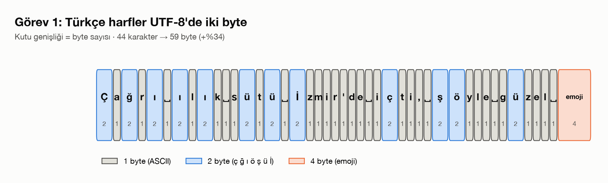
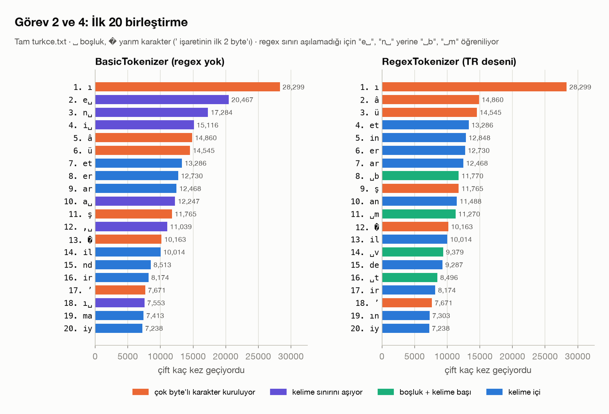
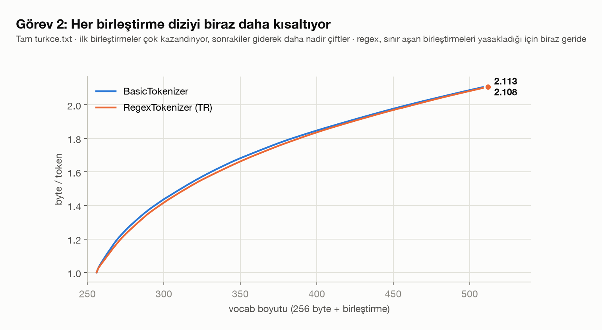
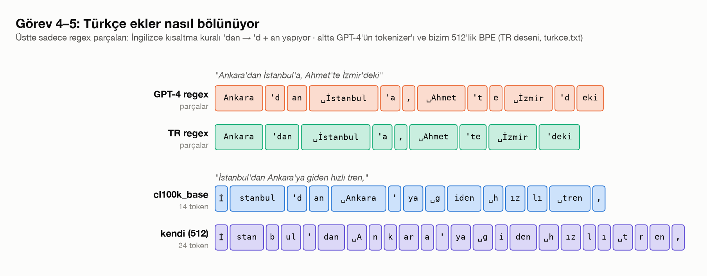
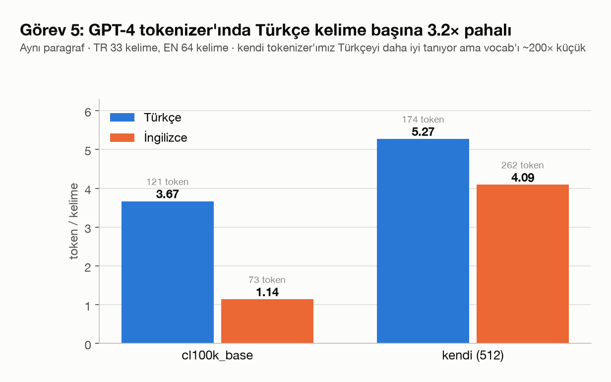
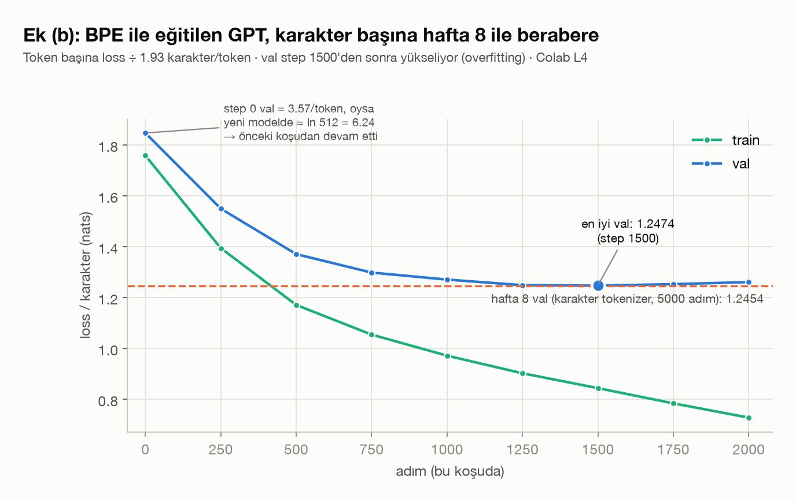

# Hafta 9: GPT Tokenizer (BPE)

## Kaynaklar
- Andrej Karpathy, [Let's build the GPT Tokenizer](https://www.youtube.com/watch?v=zduSFxRajkE)
- [karpathy/minbpe](https://github.com/karpathy/minbpe)
- [openai/tiktoken](https://github.com/openai/tiktoken) (`cl100k_base`, GPT-4 tokenizer'ı)
- Veri: hafta 8'deki `week8/turkce.txt` (Nutuk, ~1.1M karakter)

**Amaç:** hafta 8'e kadar karakter düzeyinde tokenizer kullandık. Bu hafta metnin önce UTF-8 byte'larına, sonra BPE ile öğrenilen token'lara nasıl çevrildiğini sıfırdan yazıyoruz. GPT-4'ün regex ön bölmesini ekleyip Türkçenin bu tokenizer'larda neden pahalı olduğuna bakıyoruz. Sonunda hafta 8'deki GPT'yi kendi tokenizer'ımızla yeniden eğitiyoruz.

Bu hafta çözülen görevler:
- **Görev 1:** UTF-8: Türkçe cümle için kod noktaları ve byte'lar; kod noktalarını doğrudan vocab olarak kullanmak neden kötü
- **Görev 2:** BPE'yi sıfırdan yazmak (`get_stats`, `merge`, `train`); ilk 20 birleştirme, sıkıştırma oranı
- **Görev 3:** `encode`/`decode`, Türkçe + emoji ile roundtrip
- **Görev 4:** GPT-4 regex deseni ile parça parça BPE; `Ankara'dan` ve `İstanbul'a` nasıl bölünüyor
- **Görev 5:** aynı paragraf Türkçe ve İngilizce: `cl100k_base` ve kendi tokenizer'ımız
- **Ek (b):** hafta 8 GPT'sini vocab 512'lik BPE ile eğitmek (Colab)

Görseller `make_figures.py` ile üretildi (`figures/`). Tokenizer sayıları script içinde tam `turkce.txt` üzerinde yeniden hesaplanıyor, ek (b) sayıları `samples/*.json`'dan ve `train_gpt.ipynb` çıktısından geliyor.

---

## Dosya yapısı

| Dosya | Sorumluluk |
|---|---|
| `utf_8.py` | görev 1: karakter başına kod noktası, byte sayısı, byte değerleri tablosu |
| `bpe.py` | görev 2-3: `get_stats`, `merge`, `BasicTokenizer` (`train`, `encode`, `decode`) |
| `main.py` | görev 3: Türkçe + emoji roundtrip, token token gösterim |
| `train_tokenizer.py` | görev 2: tam metinde vocab 512 eğitimi |
| `regex_tokenizer.py` | görev 4: `RegexTokenizer`, `GPT4_SPLIT_PATTERN`, `TR_SPLIT_PATTERN` |
| `compare_tr_en.py` | görev 5: TR/EN paragraf, `cl100k_base` ve kendi tokenizer'ımız |
| `train_gpt.ipynb` | ek (b): BPE tokenizer + hafta 8 GPT, Colab'da çalıştırıldı (çıktılarıyla) |
| `samples/` | ek (b) örnek metni (`.txt`) ve sonuçları (`.json`) |
| `make_figures.py` | README görselleri → `figures/` (~1 dk) |
| `week9.ipynb` | videoyu izlerken yapılan denemeler |

`checkpoints/*.pt` (54 MB) ve `bpe_cache.pt` (tokenizer + encode edilmiş veri önbelleği) repoya alınmadı.

```bash
pip install regex tiktoken
python utf_8.py
python main.py
python train_tokenizer.py
python regex_tokenizer.py
python compare_tr_en.py
python make_figures.py
```

---

## 1. UTF-8 (görev 1)

`"Çağrı ılık sütü İzmir'de içti, şöyle güzel 🌸"` → **44 karakter, 59 byte**.



| karakter | kod noktası | byte |
|---|---|---|
| `a`, `z`, `'`, boşluk | U+0061 … | 1 (ASCII) |
| `ç ğ ı ö ş ü İ` | U+00E7, U+011F, U+0131, … | 2 (ör. `ı` → `[196, 177]`) |
| `🌸` | U+1F338 | 4 (`[240, 159, 140, 184]`) |

ASCII karakterler 1 byte tutuyor. Türkçeye özgü bütün harfler 2 byte, emoji 4 byte.

**Kod noktaları neden doğrudan vocab olmuyor?**
- Unicode ~150 bin karakter tanımlıyor. Embedding tablosu ve çıkış katmanı çok büyür, çoğu karakter eğitimde neredeyse hiç görülmez.
- Standart sürekli değişiyor ve yeni karakterler ekleniyor. Byte'lar ise her zaman 256 tane.
- Ham byte'lar da tek başına yetmiyor: Türkçe metin karakter sayısından ~%10, emojili metin daha da uzun bir diziye dönüşüyor ve bağlam penceresi boşa gidiyor. Çözüm byte'lar üzerinde BPE.

## 2. BPE (görev 2)

```python
def get_stats(ids, counts=None):          # komşu çiftleri say
def merge(ids, pair, idx):                 # her (p0, p1) geçişini tek idx'e çevir
```

`train` her adımda en sık geçen çifti bulur, ona yeni bir id verir (256, 257, …) ve diziyi yeniden yazar. `vocab_size - 256` kez tekrarlanır.



**İlk 20 birleştirme** (tam `turkce.txt`, `BasicTokenizer`, figürün sol yarısı):

| # | çift | token | sayı | | # | çift | token | sayı |
|---|---|---|---|---|---|---|---|---|
| 1 | (196, 177) | `ı` | 28,299 | | 11 | (197, 159) | `ş` | 11,765 |
| 2 | (101, 32) | `e␣` | 20,467 | | 12 | (44, 32) | `,␣` | 11,039 |
| 3 | (110, 32) | `n␣` | 17,284 | | 13 | (226, 128) | `’`'nin ilk 2 byte'ı | 10,163 |
| 4 | (105, 32) | `i␣` | 15,116 | | 14 | (105, 108) | `il` | 10,014 |
| 5 | (195, 162) | `â` | 14,860 | | 15 | (110, 100) | `nd` | 8,513 |
| 6 | (195, 188) | `ü` | 14,545 | | 16 | (105, 114) | `ir` | 8,174 |
| 7 | (101, 116) | `et` | 13,286 | | 17 | (268, 153) | `’` | 7,671 |
| 8 | (101, 114) | `er` | 12,730 | | 18 | (256, 32) | `ı␣` | 7,553 |
| 9 | (97, 114) | `ar` | 12,468 | | 19 | (109, 97) | `ma` | 7,413 |
| 10 | (97, 32) | `a␣` | 12,247 | | 20 | (105, 121) | `iy` | 7,238 |

- İlk birleştirme `ı`: BPE, Türkçe harflerin iki byte'ını önce birleştirip "karakteri geri kuruyor" (`ı`, `â`, `ü`, `ş`). Nutuk'un Osmanlıca kelimeleri yüzünden `â` bu kadar erken çıkıyor.
- `’` (3 byte) iki adımda kuruluyor: 13. birleştirme ilk iki byte (tek başına geçersiz UTF-8, `�` olarak görünür), 17. birleştirme bu token'a üçüncü byte'ı ekliyor (`268` id'li token).
- `e␣`, `n␣`, `ı␣`: kelime sonu + boşluk. Regex ön bölmesi olmadığı için birleştirmeler kelime sınırını aşıyor (görev 4'te bu değişiyor).
- 18. birleştirme (`256, 32`) daha önce öğrenilmiş bir token'ı kullanıyor: BPE ağaç gibi büyüyor.

**Sıkıştırma:** vocab 512 → **2.11 byte/token** (1.91 karakter/token), tam metinde ~39 sn. İlk 100k karakterde 2.14.



Eğri başta dik, sonra yatıklaşıyor. İlk birleştirmeler on binlerce kez geçen çiftleri tek token'a indiriyor (`ı` tek başına 28k byte kazandırıyor), 256. birleştirmedeki çift ise sadece birkaç yüz kez geçiyor. Regex'li tokenizer sınır aşan birleştirmeleri yapamadığı için hep biraz geride kalıyor (2.108 ve 2.113), ama fark çok küçük.

## 3. encode / decode (görev 3)

- `decode`: id → byte dizisi (`vocab`), birleştir, `bytes.decode("utf-8", errors="replace")`.
- `encode`: metni byte'lara çevir; dizide, `merges` içinde **en erken öğrenilmiş** çifti bul (`min(..., key=merges.get)`) ve birleştir; birleştirilecek çift kalmayınca dur. Sıra önemli: eğitimdeki sırayla birleştirmezsek sonraki birleştirmeler (ör. `ı␣` = `256 + 32`) hiç oluşmaz.

`"Merhaba Dünya! 🇹🇷 Her şey çok güzel 🌸"` → **50 byte → 36 token**, `decode(encode(x)) == x` → `True`. Emojiler eğitim verisinde yok, bu yüzden 4 ham byte olarak kalıyor (`🇹🇷` = 8 token).

**`errors="replace"` neden gerekli?** Model her id dizisini üretebilir. Örneğin tek başına `240` (4 byte'lık bir karakterin ilk byte'ı) ya da 13. birleştirmedeki `’`'nin yarısı geçerli UTF-8 değildir. `errors="strict"` ile `decode` bu durumda hata verir. `replace` ise bozuk kısmı `�` yapıp devam eder.

## 4. GPT-4 regex deseni (görev 4)

```python
GPT4_SPLIT_PATTERN = r"""'(?i:[sdmt]|ll|ve|re)|[^\r\n\p{L}\p{N}]?+\p{L}+|\p{N}{1,3}| ?[^\s\p{L}\p{N}]++[\r\n]*|\s*[\r\n]|\s+(?!\S)|\s+"""
```

`RegexTokenizer` metni önce bu desenle parçalara ayırıyor, BPE'yi her parçada **ayrı** çalıştırıyor (`get_stats(chunk, stats)` ile sayımlar parçalar boyunca toplanıyor). Birleştirmeler parça sınırını hiçbir zaman aşmıyor: harf ile noktalama, kelime ile sonraki boşluk asla aynı token'a girmiyor. Bu yüzden `e␣`, `n␣`, `i␣` gibi birleştirmeler yerine `␣b`, `␣m`, `␣v`, `␣t` gibi **boşluk + kelime başı** token'ları öğreniliyor (figür 2'nin sağ yarısı, yeşil). Çok byte'lı karakterlerin geri kurulması (turuncu) iki tokenizer'da da aynı sırayla gidiyor.

**`Ankara'dan İstanbul'a, Ahmet'te Ayşe'nin Ali'ler İzmir'deki`:**

| desen | parçalar |
|---|---|
| GPT-4 | `Ankara` `'d` `an` `␣İstanbul` `'a` `,` `␣Ahmet` `'t` `e` `␣Ayşe` `'nin` `␣Ali` `'ler` `␣İzmir` `'d` `eki` |
| `TR_SPLIT_PATTERN` | `Ankara` `'dan` `␣İstanbul` `'a` `,` `␣Ahmet` `'te` `␣Ayşe` `'nin` `␣Ali` `'ler` `␣İzmir` `'deki` |



GPT-4 desenindeki ilk alternatif İngilizce kısaltmalar için (`'s`, `'d`, `'t`, `'ll`, …). Türkçe ekler `d`/`t` ile başlayınca bu kural ekin ilk harfini koparıyor: `'dan` → `'d` + `an`, `'te` → `'t` + `e`. `TR_SPLIT_PATTERN` bu alternatifi çıkarıyor ve ek bütün kalıyor. Roundtrip iki desende de `True`.

Nutuk'ta düz `'` yerine hep `’` (U+2019, 7,671 kez) kullanılmış. Kısaltma kuralı hiç tetiklenmediği için iki desen bu metinde aynı birleştirmeleri öğreniyor (örnek cümlede 53 = 53 token). Fark düz `'` kullanan metinlerde ortaya çıkıyor.

## 5. Türkçe ve İngilizce (görev 5)

Aynı paragraf (İstanbul–Ankara tren yolculuğu), iki dilde:



| | kelime | byte | token | token/kelime | byte/token |
|---|---|---|---|---|---|
| TR / `cl100k_base` | 33 | 338 | 121 | **3.67** | 2.79 |
| EN / `cl100k_base` | 64 | 370 | 73 | **1.14** | 5.07 |
| TR / kendi (512) | 33 | 338 | 174 | 5.27 | 1.94 |
| EN / kendi (512) | 64 | 370 | 262 | 4.09 | 1.41 |

- **`cl100k` ile Türkçe kelime başına ~3.2 kat daha pahalı.** Aynı anlam İngilizcede 73, Türkçede 121 token. Bağlam penceresine daha az metin sığıyor, API maliyeti artıyor. Sebebi eğitim verisinin büyük kısmının İngilizce olması: İngilizce kelimeler tek token, Türkçe kelimeler eklere ve hece parçalarına bölünüyor.
- `cl100k`: `İ | stanbul | 'd | an` (figür 4'ün alt yarısı). `İ` 2 byte'lık nadir bir harf olduğu için ayrı token oluyor, `'dan` görev 4'teki kısaltma kuralıyla bölünüyor.
- **Kendi tokenizer'ımız Türkçede daha verimli** (TR 1.94 ve EN 1.41 byte/token). Eğitim verisi Türkçe olduğu için Türkçe parçaları öğrenmiş. Ama vocab'ı ~200 kat küçük (512, cl100k ~100k) olduğu için toplam token sayısı yine daha fazla (174, cl100k 121).
- Tek kelimeler: `gecikmeyeceğini` iki tokenizer'da da 8 token, `impatiently` cl100k'da 3, bizimkinde 8.

## 6. Ek (b): hafta 8 GPT'si BPE ile

`train_gpt.ipynb`, Colab (NVIDIA L4). Model hafta 8'in `video` config'iyle aynı: `n_embd` 384, 6 head, 6 katman, `block_size` 256, batch 64, dropout 0.2, AdamW 3e-4. Tek fark tokenizer: karakter (vocab 104) yerine `RegexTokenizer` + `TR_SPLIT_PATTERN` (vocab 512).

- Tokenizer eğitimi + encode: 113 sn. 1,101,042 karakter → **573,620 token** (1.93 karakter/token).
- 11,132,672 parametre. Hafta 8'de 10,818,920 parametre vardı, fark 512'lik embedding ve çıkış katmanından geliyor.

| step | train | val |
|---|---|---|
| 0 | 3.3978 | 3.5698 |
| 500 | 2.2634 | 2.6493 |
| 1000 | 1.8782 | 2.4561 |
| 1500 | 1.6316 | **2.4101** |
| 1750 | 1.5160 | 2.4213 |
| 2000 (son) | 1.4075 | 2.4372 |

### 6.1 Karakter başına karşılaştırma



Token başına loss'u hafta 8'in karakter başına loss'uyla doğrudan kıyaslayamayız: bir token ortalama 1.93 karakter taşıyor, yani tek tahminde daha fazla bilgi tahmin ediliyor. Metnin toplam loss'u aynı kalacak şekilde token başına loss'u karakter/token oranına bölünce iki değer aynı birime (nats/karakter) geliyor.

| | val (token başına) | val (karakter başına) | train−val farkı (karakter başına) |
|---|---|---|---|
| hafta 8, karakter, 5000 adım | — | **1.2454** | 0.456 |
| hafta 9, BPE 512, en iyi (step 1500) | 2.4101 | **1.2474** | — |
| hafta 9, BPE 512, son | 2.4372 | 1.2614 | 0.533 |

- **Kalite neredeyse aynı.** En iyi checkpoint'te karakter başına val 1.2474, hafta 8'de 1.2454. Bu veri boyutunda ve 512'lik vocab'da BPE, modelin metni daha iyi modellemesini sağlamadı.
- **Kazanç verimlilikte.** Aynı `block_size=256` ile model artık ~495 karakter görüyor (hafta 8'de 256). Bağlam iki kat büyüdü ama attention maliyeti aynı kaldı. Aynı uzunlukta metin üretmek için yarı sayıda adım yetiyor.
- **Overfitting daha erken başlıyor.** Val step 1500'den sonra yükseliyor, train düşmeye devam ediyor. Veri token cinsinden yarıya indi (~516k train token'ı), model ise aynı büyüklükte. Bu yüzden en iyi val'deki ağırlıklar ayrıca `checkpoints/turkce_bpe512_best.pt`'ye kaydedildi.

### 6.2 Örnek metin (500 token ≈ 1000 karakter)

```
Efendiler, vaziyeti haberdâr olup Cemal Paşa’dan bazı maksadını tahtında da takarrürüne
tebaiyet etmiştim, Cumhuriyet’in ilânına tevfîkanın İsmet Paşa’ya yazıldığı diğer mektup
şu cümle hulâsa etmiştim: [...]

Harbiye Nâzırı Cemal Paşa Hazretlerine
[...]
Şifre

Bekir Sami Bey
```

Hafta 8 örneğinde `müzherem`, `bildiriyorduğum`, `unuturursa` gibi uydurma kelimeler vardı. Burada kelimelerin neredeyse hepsi gerçek, kişi ve makam adları doğru yazılıyor. BPE sık geçen kökleri ve ekleri tek token olarak verdiği için modelin kelimeleri harf harf kurması gerekmiyor. Nutuk'un biçimini de yakalamış (`Efendiler,` ile başlayan paragraflar, telgraf başlıkları, `Şifre` blokları). Cümleler ise hâlâ anlamsız.

### 6.3 Bu koşunun bir kusuru

Step 0'daki loss 3.40. Yeni başlatılmış bir model 512 token arasından rastgele tahmin yaptığı için loss ≈ ln(512) = 6.24 olmalıydı. Defterin çalıştırma sırası da bunu doğruluyor: eğitim hücresi, model oluşturulduktan sonra daha önce en az bir kez çalıştırılmış (kesilen bir koşu), sonra `MAX_STEPS = 2000` ile **aynı model üzerinde** yeniden başlatılmış. Yani:
- model toplamda 2000'den fazla adım eğitildi, gerçek sayı bilinmiyor;
- 485 sn toplam süre değil (GPU da hafta 8'deki T4 değil L4, süreler zaten kıyaslanamaz);
- erken overfitting'in bir kısmı bundan kaynaklanıyor olabilir.

Temiz bir karşılaştırma için 5. bölümden (model oluşturma) itibaren baştan çalıştırmak gerekiyor.

---

## Özet

- UTF-8'de Türkçe harfler 2 byte. BPE'nin ilk işi bu byte'ları geri birleştirmek oluyor (ilk birleştirme `ı`).
- Regex ön bölmesi birleştirmelerin kelime/noktalama sınırını aşmasını engelliyor. GPT-4'ün İngilizce kısaltma kuralı ise Türkçe ekleri (`'dan` → `'d` + `an`) bölüyor.
- `cl100k_base` ile Türkçe, aynı anlam için İngilizceden kelime başına ~3.2 kat daha fazla token harcıyor.
- Aynı GPT'yi BPE ile eğitmek karakter başına kaliteyi değiştirmedi (1.2474 ile 1.2454). Bağlamı iki katına çıkardı, kelimeleri düzeltti ve overfitting'i hızlandırdı.
